# Embedded Proof-of-Device Network (EPDN)

**An open-source MVP exploring how registered embedded devices can participate in a test network without competing on compute power.**

> New to embedded systems, cryptography, or blockchain concepts? Start with the [EPDN Beginner’s Guide](docs/EPDN_BEGINNERS_GUIDE.md) for a plain-language explanation of how the project works.

[](https://github.com/UfkuAcik/Embedded_Proof-of-Device_Network/actions/workflows/ci.yml)


> [!WARNING]
> EPDN is a **research and development test network**. It is not a production
> network, an investment product, a cryptocurrency with real-world value, or a
> system that has passed an independent security audit. Test keys and test units
> must not be treated as real money.

<a id="epdn-in-one-minute"></a>
## EPDN in one minute

You can think of EPDN as a lottery:

1. An embedded device is first registered with the network.
2. In each protocol round—designed around a **30-second schedule**—the network
   allows each registered identity at most one ticket.
3. The device signs its ticket with its private key.
4. The validator checks the ticket, the device certificate, and the network
   rules.
5. The valid ticket with the lowest numerical score wins the round.
6. A test-network-only reward is credited to the winner's pre-registered
   reward address.

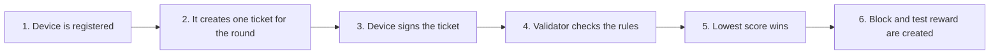

The key difference is that, in classic Proof of Work systems, more compute power
provides more attempts. In EPDN, using a faster processor, GPU, FPGA, or ASIC
does not provide extra tickets for the same registered identity.

> [!IMPORTANT]
> In this MVP, “one device” technically means **one registered cryptographic
> identity**. If the current development key can be copied, two physical devices
> can use the same identity. Claiming true physical uniqueness requires a
> verified, non-exportable hardware key.

<a id="table-of-contents"></a>
## Table of contents

- [EPDN in one minute](#epdn-in-one-minute)
- [What problem does the project explore?](#problem)
- [What EPDN is—and is not](#what-it-is-and-is-not)
- [Current status](#current-status)
- [Glossary of core concepts](#glossary)
- [System architecture](#architecture)
- [Components and responsibilities](#components)
- [End-to-end flow](#end-to-end-flow)
- [How does PoPED work?](#poped)
- [What happens during an epoch?](#epoch)
- [Why are device identity and wallet identity separate?](#key-separation)
- [Hardware support](#hardware-support)
- [Security classes](#security-classes)
- [Trust and threat model](#trust-model)
- [Privacy and data boundaries](#privacy)
- [Quick start](#quick-start)
  - [Path 1: View only the interface](#dashboard-demo)
  - [Path 2: Local validator and dashboard](#local-validator)
  - [Path 3: Three-process test](#three-process-test)
  - [Path 4: Compile the ESP32 code](#esp32-build)
- [Repository layout](#repository-layout)
- [API overview](#api-overview)
- [Tests and quality gates](#tests)
- [Known limitations](#limitations)
- [Documentation](#documentation)
- [Roadmap](#roadmap)
- [Contributing and security reports](#contributing)
- [License](#license)

---

<a id="problem"></a>
## What problem does the project explore?

Many blockchain systems limit participation through compute power, money, or
another scarce resource. EPDN explores this question:

> “If we give each pre-registered embedded-device identity only one opportunity
> to participate per round, can we build a deterministic and verifiable test
> network without a race for compute power?”

This approach separates three concerns:

- **Device participation identity:** Used by the device to sign tickets.
- **Wallet ownership:** Used to receive rewards and sign transfers.
- **Network validation:** The validator enforces every certificate, signature,
  replay, and state rule.

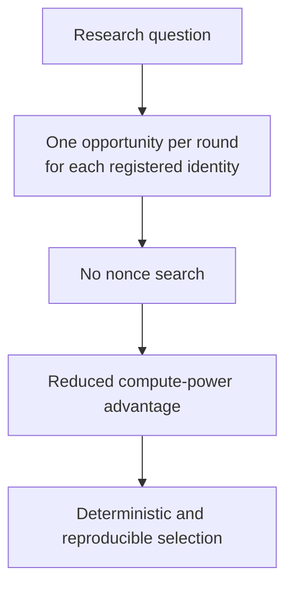

<a id="what-it-is-and-is-not"></a>
## What EPDN is—and is not

| EPDN is... | Explanation |
|---|---|
| **An experimental test network** | The protocol, devices, validator, and interface can be tried together. |
| **An exploration of proof of device** | Participation rights are tied to registered cryptographic identities. |
| **Deterministic** | The same valid inputs produce the same ticket order and result. |
| **A multi-component example** | Rust, Arduino/C++, Python, and TypeScript components work together. |
| **Explicit about its security boundaries** | Unsupported production settings do not silently fall back to a weak mode. |

| EPDN is not... | Why? |
|---|---|
| **A mainnet or a real cryptocurrency** | Its units exist only for testing and carry no promise of real-world value. |
| **Proof of Work** | There is no nonce search or race for hash power. |
| **A guarantee of physical-device uniqueness** | The current ESP32 development key is stored in software. |
| **A fully decentralized network** | The working MVP uses a single-validator model. |
| **Production ready** | Independent auditing, P2P finality, and verified hardware keys are still missing. |
| **Compatible with every embedded board today** | The protocol is designed to be portable, but the working device layer is currently centered on ESP32. |

<a id="current-status"></a>
## Current status

| Area | Current status |
|---|---|
| Protocol and rules | Implemented in Rust and covered by tests |
| Validator node | Working REST/SSE service for local development |
| Device firmware | Centered on ESP32 within the Arduino ecosystem |
| Physical testing | UART gateway flow verified on one classic ESP32-family target |
| Additional ESP32 targets | `WiFiMiner` is compiled in CI for ESP32-S2, ESP32-S3, and ESP32-C3 |
| Other embedded families | Architecture target/roadmap only; no ready, verified client |
| Dashboard and wallet | Installable PWA that can run locally |
| Indexer | Rebuildable SQLite view with JSON export |
| Three-validator experiment | Three separate local API processes with a deterministic comparison test |
| Production mode | A design target; not yet a usable production network |

The project's long-term target is not limited to ESP32. Throughout this README,
however, **implemented**, **compiled only**, **physically tested**, and
**planned** are kept deliberately distinct.

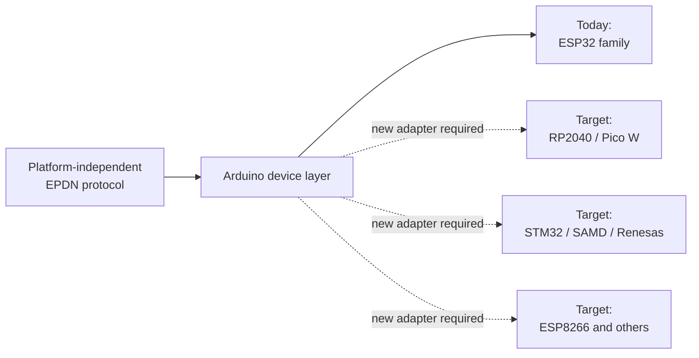

<a id="glossary"></a>
## Glossary

| Term | Plain-language meaning |
|---|---|
| **Node / Validator** | The Rust service that applies network rules and creates valid blocks. |
| **Miner / Device** | An embedded device that prepares at most one ticket per round with its registered identity. |
| **Provisioning** | Giving a device a development identity/certificate and registering it with the validator. |
| **Device certificate** | A signed record showing that a device key is accepted by this test network. |
| **Epoch** | A protocol round designed around a 30-second schedule; the current node advances it through an explicit finalize call. |
| **Ticket** | Deterministic data representing the device's participation in a round. |
| **PoPED** | `Proof of Provisioned Embedded Device`; the one-ticket-per-registered-identity rule. |
| **Gateway** | An untrusted bridge that carries already-signed UART data to the node. |
| **Indexer** | Builds a queryable SQLite view from finalized blocks. |
| **Wallet** | A local browser wallet using a separate key to receive and send test units. |
| **PWA** | A web interface that can be installed like an application on supported systems. |
| **Hash** | A fixed-length digital fingerprint of data. If the data changes, the hash changes. |
| **Canonical** | Representing the same information in exactly one valid byte layout. |
| **REST / SSE** | REST is a request-response API; SSE streams node events to the dashboard. |
| **CI** | Automatically runs builds, tests, and security checks for every code change. |
| **P2P / Finality** | Nodes communicating directly and agreeing that a block can no longer change. |
| **Secure element** | A separate security chip that signs inside the device without exporting the private key. |
| **L0–L4** | Security classes describing how strongly the device key is protected. |

<a id="architecture"></a>
## System architecture

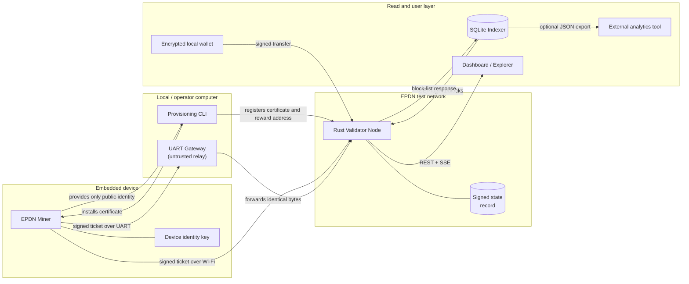

The arrows matter:

- The gateway does not sign on behalf of the device; it only carries bytes.
- The miner does not know the wallet private key; it knows only the public
  address that receives rewards.
- The indexer is not the source of truth; it can be deleted and rebuilt from
  validator data.
- JSON is used only at API boundaries. Signed and hashed values use the
  fixed-order `EPDN Binary Encoding v1` format.

<a id="components"></a>
## Components and responsibilities

| Component | Language | What does it do? | What does it not do? |
|---|---|---|---|
| [`protocol/`](protocol/) | Rust | Encoding, certificate, ticket, block, transaction, and selection rules | Does not contain an HTTP interface or device driver |
| [`node/`](node/) | Rust | Validator, registry, epochs, rewards, transfers, revocations, REST/SSE, and persistent state | Does not provide production-grade P2P consensus |
| [`arduino/`](arduino/) | C++ / Arduino | Device identity, ticket engine, and Wi-Fi/UART miner examples | Does not support every board family today |
| [`provisioning/`](provisioning/) | Python | Inspection, development enrollment, flashing, monitoring, and revocation tools | Does not make irreversible eFuse changes in this MVP |
| [`gateway/`](gateway/) | Python | Bounded data relay between a UART device and the node | Does not hold a private key or sign for the device |
| [`indexer/`](indexer/) | Python / SQLite | Validates finalized blocks and builds a queryable view | Does not replace the validator |
| [`dashboard/`](dashboard/) | TypeScript / React | Explorer, device panel, PWA, and encrypted local wallet | Does not pretend demo data is live when no validator is available |
| [`scripts/testnet.py`](scripts/testnet.py) | Python | Starts three local node processes and runs a smoke test | Does not turn those processes into P2P peers |

<a id="end-to-end-flow"></a>
## End-to-end flow

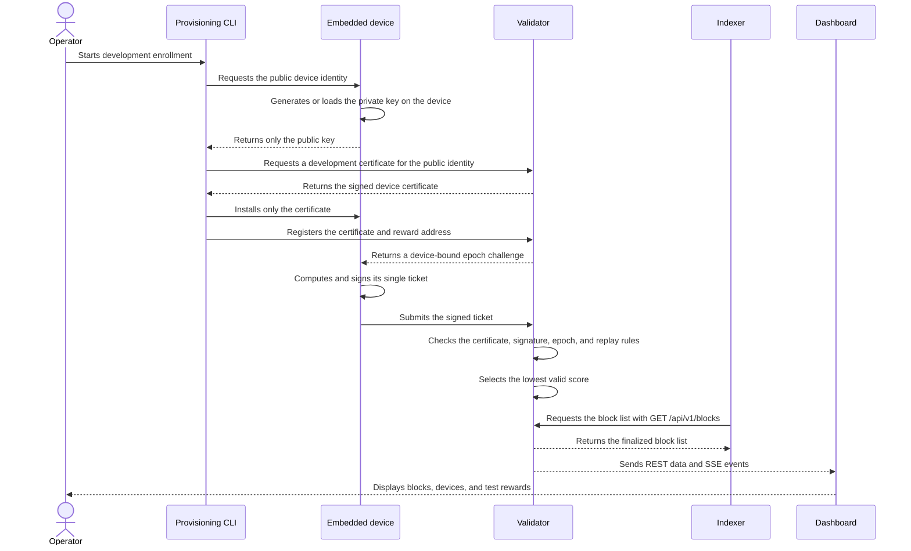

A valid signature alone is not enough for a ticket to be accepted. The validator
also checks the network identity, epoch, previous-block link, firmware policy,
certificate lifetime, security class, revocation status, packet size, and replay
status.

<a id="poped"></a>
## How does PoPED work?

`Proof of Provisioned Embedded Device (PoPED)` gives each registered identity at
most one deterministic result per epoch.

In simplified form:

```text
ticket = SHA256("EPDN_TICKET_V1" || device_public_key_hash || epoch_challenge)
score  = SHA256("EPDN_SCORE_V1"  || ticket)
```

The signature proves that the device possesses the registered private key.
However, the signature bytes are not included in the ticket score. A device
therefore cannot search for a better score by producing different valid ECDSA
signatures for the same message.

| Property | Proof of Work | EPDN PoPED MVP |
|---|---|---|
| Source of participation | Computing power | Registered device identity |
| Attempts per round | Many, depending on hardware speed | At most one per identity |
| Nonce search (trying many values to find a solution) | Yes | No |
| Advantage from a faster GPU/ASIC | Usually yes | Does not provide extra tickets for the same identity |
| Primary trust assumption | Economic and computational cost | Provisioning authority and device key |
| Physical-device guarantee | No | Not in the MVP; requires a hardware-backed key |

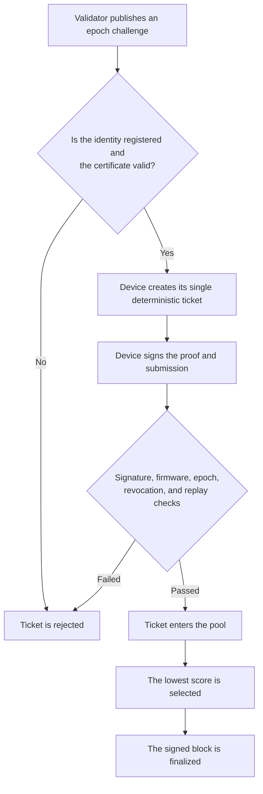

For the complete format and security rationale, see
[`PROTOCOL.md`](PROTOCOL.md) and
[`docs/consensus.md`](docs/consensus.md).

<a id="epoch"></a>
## What happens during an epoch?

The protocol design uses a **30-second epoch schedule**:

- First 20 seconds: ticket-submission window.
- Last 10 seconds: finalization window.
- A deterministic winner is selected from the valid tickets.
- Transfers and revocations become final only after they are included in a block.

The current single-node MVP does **not** run an autonomous wall-clock scheduler.
An operator or test harness advances the epoch explicitly with
`POST /api/v1/admin/epochs/finalize`. The 20/10-second split below documents the
intended protocol schedule, not an automatic timer enforced by the current
server. If there are neither accepted tickets nor pending revocations, the
finalize request returns an error and the current epoch does not advance.

```mermaid
stateDiagram-v2
    [*] --> TicketWindow
    TicketWindow: 0–20 seconds
    TicketWindow: Valid tickets are accepted
    TicketWindow --> FinalizationWindow: At 20 seconds
    FinalizationWindow: 20–30 seconds
    FinalizationWindow: New tickets are rejected
    FinalizationWindow --> Validation: Epoch closes
    Validation --> NormalBlock: A valid winner exists
    Validation --> ManagementBlock: Only revocations need finalization
    Validation --> NoChange: No tickets or pending revocations
    NormalBlock --> [*]
    ManagementBlock --> [*]
    NoChange --> TicketWindow: Finalize is rejected; same epoch remains
```

The order in which packets reach the node is not used to choose the winner.
Canonical values such as the device public-key hash and submission hash break
ties.

<a id="key-separation"></a>
## Why are the device identity and wallet separate?

EPDN uses two different private keys:

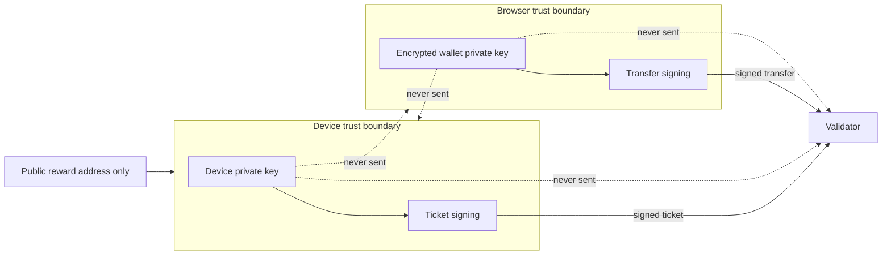

- The **device key** proves that the miner is a registered participant.
- The **wallet key** authorizes spending test units.
- The miner knows only the public reward address.
- Writing the wallet private key into firmware violates the design.
- Sending the device private key to the dashboard also violates the design.

<a id="hardware-support"></a>
## Hardware support

### What do the labels mean?

| Label | Meaning |
|---|---|
| **Physical test** | The code was run on a real board and its behavior was observed. |
| **CI build** | The code compiled for the target; this does not claim that it ran on a real board. |
| **Planned** | The architecture has a target, but support is not complete or verified. |

### Current support matrix

| Hardware / family | Status | Coverage |
|---|---|---|
| One classic ESP32-family target | **Physical test + CI build** | UART gateway, protocol vectors, enrollment, tickets, rewards, and revocation flow |
| ESP32-S2 | **CI build** | `WiFiMiner` only; no physical test |
| ESP32-S3 | **CI build** | `WiFiMiner` only; no physical test |
| ESP32-C3 | **CI build** | `WiFiMiner` only; no physical test |
| ESP32-C2/C5/C6/C61/H2/P4 | **Planned** | Requires network and identity adapters appropriate for each model |
| ESP8266 | **Planned** | No ready or verified miner |
| RP2040 / Raspberry Pi Pico W | **Planned** | No ready or verified miner |
| SAMD / Nano / MKR family | **Planned** | Board and secure-element capabilities must be verified separately |
| STM32 Arduino cores | **Planned** | Requires MCU- and board-specific adapters |
| Renesas Arduino cores | **Planned** | Requires target-specific adapters |
| ATECC608A / ECC508 | **Planned** | The current example is a fail-closed placeholder, not a real integration |

> [!NOTE]
> A successful build for ESP32-S2/S3/C3 does not mean that Wi-Fi was tested
> end to end or that the target was verified on physical hardware. The physical
> test on that classic ESP32-family target also does not make the board's private key
> unclonable at the hardware level.

Physical evidence:
[`arduino/HARDWARE_TEST_REPORT.md`](arduino/HARDWARE_TEST_REPORT.md) and
[`arduino/board-configs/support-matrix.json`](arduino/board-configs/support-matrix.json).

<a id="security-classes"></a>
## Security classes

EPDN classifies identity-storage strength from L0 through L4:

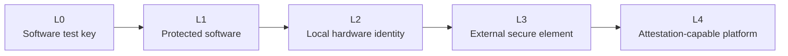

| Class | Plain-language meaning | Status in this repository |
|---|---|---|
| **L0** | Exportable development/test key | Current ESP32 development path |
| **L1** | Software-accessible key in more protected storage | Requires target-specific evidence |
| **L2** | Signing operation bound to local hardware | No verified general-purpose backend yet |
| **L3** | Key never leaves a secure element | ATECC integration is planned |
| **L4** | Platform presents signed measurements through attestation | Design target |

Production policy rejects L0 identities. A board does not qualify for L2 or L4
merely because its name contains “secure” or “ESP32.” For details, see
[`docs/security-classes.md`](docs/security-classes.md).

<a id="trust-model"></a>
## Trust and threat model

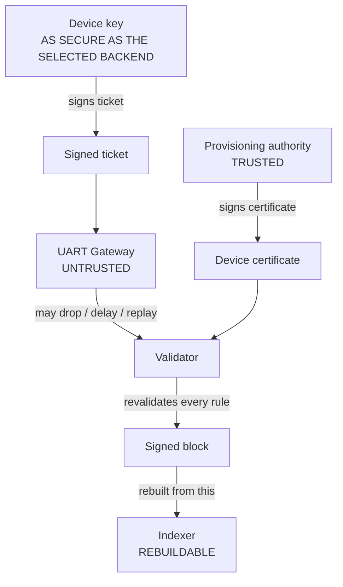

The system relies on these assumptions:

- The provisioning authority must not create fraudulent identities.
- The validator's CA and block-signing keys must be protected.
- A device key is only as secure as its selected backend.
- The gateway is not trusted; the node revalidates incoming data.
- A MAC address, IP address, RSSI value, board model, reset reason, or timing
  information is not a root of trust for device identity.

Important safeguards:

- P-256 signatures and SHA-256 hashes with domain separation.
- Fixed-order, size-limited canonical binary encoding.
- One ticket per identity per epoch, plus duplicate and replay checks.
- Certificate, firmware, security-class, and revocation policies.
- Signed, checksummed, and atomically stored V3 node state.
- A strong admin token, an exact CORS allowlist, and distinct CA and validator
  keys are mandatory when the node listens beyond loopback.
- Unsupported production backends fail instead of silently weakening security.

For the complete threat model, see [`THREAT_MODEL.md`](THREAT_MODEL.md).

<a id="privacy"></a>
## Privacy and data boundaries

EPDN is not an anonymity product. Blocks, transactions, reward addresses, and
public device identities may be public testnet data. The privacy goal is to keep
unnecessary personal and device-identifying data from leaking into source code,
logs, or the public explorer.

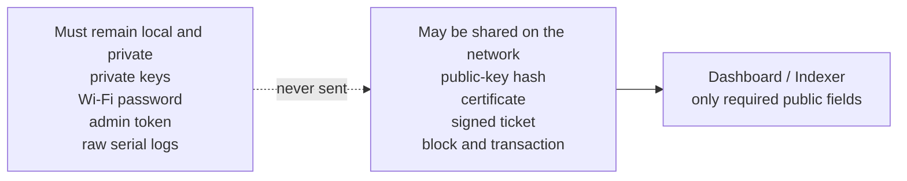

| Data | Where it should live |
|---|---|
| Device private key | Only in the device's selected identity backend |
| Wallet private key | Encrypted IndexedDB record and browser memory while unlocked |
| Wi-Fi password | Interactive local input and the device's local storage |
| Admin token | Local/runtime environment variable |
| Raw serial-port output | Local test directory ignored by Git |
| Public device identity and certificate | Testnet registry |
| Blocks and signed transactions | Public testnet data |
| Personal device label | Authorized dashboard application data only |

Do not put the following in an issue, commit, screenshot, or public log:

- Private keys or recovery data
- Wi-Fi SSIDs or passwords
- Admin tokens
- Complete serial-port dumps
- MAC addresses, USB identities, or unique chip identities
- eFuse or security-posture dumps
- Personal file paths, user names, or email addresses

<a id="quick-start"></a>
## Quick start

First, choose what you want to see:

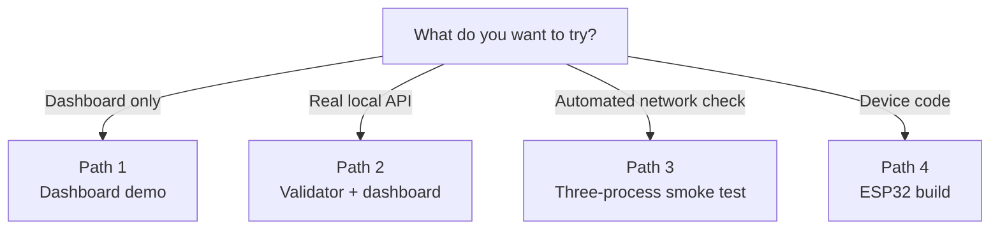

### Requirements

You only need to install the tools required by the path you choose.

| Tool | Version | Where is it needed? |
|---|---:|---|
| Git | Current | Cloning the repository |
| Rust | 1.85 | Protocol and node |
| Python | 3.11+ | Provisioning, gateway, indexer, and testnet script |
| Node.js | 22.13+ | Dashboard/PWA |
| Arduino CLI | 1.5.0 | Building ESP32 code |
| ESP32 Arduino core | 2.0.11 | ESP32 targets |
| Docker | Optional | Node container |

Clone the repository:

```bash
git clone https://github.com/UfkuAcik/Embedded_Proof-of-Device_Network.git
cd Embedded_Proof-of-Device_Network
```

<a id="dashboard-demo"></a>
### Path 1: View only the dashboard

This path does not require physical hardware, Rust, or Python. If no validator is
available, the dashboard clearly displays a **DEMO DATA** label and uses
deterministic sample data.

```bash
cd dashboard
npm ci
npm run dev
```

Open [http://localhost:3000](http://localhost:3000) in your browser.

Expected result:

- The explorer opens.
- Sample blocks and devices are displayed.
- A notice at the top makes it clear that this is demo data, not a live network.
- Wallet transfers are not broadcast while the interface is in demo mode.
- Administrative revocation uses the server-configured validator target rather
  than the demo/live label. Configure that target and its admin token only for
  a validator you intend to control.

<a id="local-validator"></a>
### Path 2: Local validator and dashboard

#### 1. Start the validator

From the repository root:

```bash
cargo run -p epdn-node
```

By default, the node listens only on `127.0.0.1:8745`. Check its health:

```bash
curl http://127.0.0.1:8745/healthz
```

Loopback development mode may use local, intentionally insecure default keys.
Before making the node accessible to other computers, read the mandatory
security variables in [`node/README.md`](node/README.md).

#### 2. Connect the dashboard to the node

Open a new terminal.

PowerShell:

```powershell
Set-Location dashboard
$env:EPDN_API_BASE_URL = "http://127.0.0.1:8745"
npm ci
npm run dev
```

Bash:

```bash
cd dashboard
npm ci
EPDN_API_BASE_URL=http://127.0.0.1:8745 npm run dev
```

You can also select `http://127.0.0.1:8745` in the dashboard's API field. If the
connection succeeds, the data source is shown as the live node instead of the
demo.

<a id="three-process-test"></a>
### Path 3: Three-process test

```bash
python scripts/testnet.py smoke
```

This command:

1. Builds the current `epdn-node` code.
2. Starts three separate local processes on ports `8745`, `8746`, and `8747`.
3. Checks health and basic network information.
4. Runs a deterministic commit/reveal test with three validators.
5. Stops the processes and removes temporary state.

If those ports are in use:

```bash
python scripts/testnet.py --ports 18745,18746,18747 smoke
```

> [!CAUTION]
> These three processes are not P2P peers that exchange blocks or votes. The test
> verifies independent API processes and deterministic results for identical
> protocol inputs; it does not prove Byzantine finality.

<a id="esp32-build"></a>
### Path 4: Build the ESP32 code

First, install the pinned ESP32 core:

```bash
arduino-cli config init
arduino-cli config add board_manager.additional_urls https://espressif.github.io/arduino-esp32/package_esp32_index.json
arduino-cli core update-index
arduino-cli core install esp32:esp32@2.0.11
```

Compile the diagnostic example without uploading anything to the hardware:

```bash
arduino-cli compile \
  --fqbn esp32:esp32:esp32 \
  --libraries arduino/libraries \
  arduino/examples/SecurityDiagnostic
```

In PowerShell, the same command can be run on one line:

```powershell
arduino-cli compile --fqbn esp32:esp32:esp32 --libraries arduino/libraries arduino/examples/SecurityDiagnostic
```

Other examples:

| Example | Purpose |
|---|---|
| `SecurityDiagnostic` | Safely inspects the security capabilities reported by the target |
| `SerialProvisioning` | Receives Wi-Fi and development enrollment data over a serial connection |
| `WiFiMiner` | Communicates directly with the node over Wi-Fi |
| `GatewayMiner` | Sends a signed ticket through the UART gateway |
| `ProtocolTestVectors` | Confirms that Rust and Arduino encoding produce the same bytes |
| `SecureElementMiner` | A fail-closed placeholder for the planned secure-element path |

> [!CAUTION]
> Compilation does not change the hardware; an **upload** replaces the
> application currently stored on the board. Do not upload until you have
> verified the correct board/FQBN and port yourself. This project does not
> automatically change eFuse, Secure Boot, Flash Encryption, JTAG, or
> anti-rollback settings.

For device setup, see
[`arduino/README.md`](arduino/README.md),
[`docs/hardware-testing.md`](docs/hardware-testing.md), and
[`docs/wifi-provisioning.md`](docs/wifi-provisioning.md).

<a id="repository-layout"></a>
## Repository layout

```text
Embedded_Proof-of-Device_Network/
├── protocol/       Consensus rules and canonical binary encoding
├── node/           Rust validator, REST/SSE API, and persistent state
├── arduino/        EPDN device library and ESP32 examples
├── provisioning/   Device enrollment and management CLI
├── gateway/        Signed-data relay between UART and the node
├── indexer/        SQLite read model and JSON export
├── dashboard/      Explorer, device panel, and local-wallet PWA
├── scripts/        Testnet runner and secret scanner
├── tests/          Privacy-preserving hardware evidence
├── docs/           Architecture and operations documentation
├── PROTOCOL.md     Protocol trust boundary
├── THREAT_MODEL.md Threat model
├── ROADMAP.md      Planned improvements
└── SECURITY.md     Vulnerability reporting policy
```

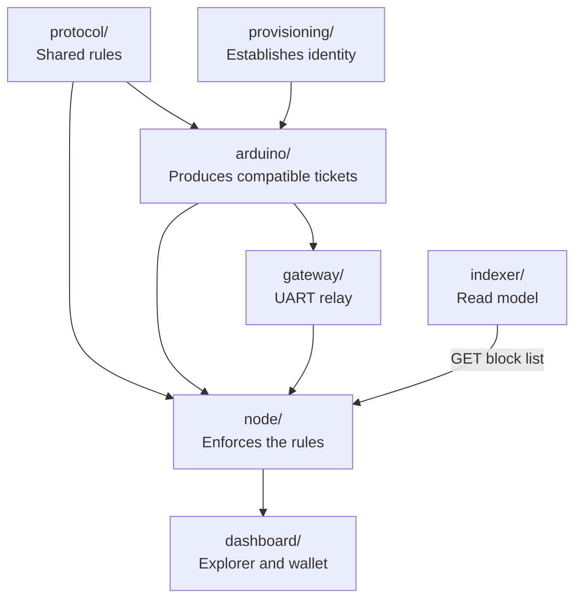

<a id="api-overview"></a>
## API overview

The node exposes two types of endpoints:

| Type | Examples | Authorization |
|---|---|---|
| Health/network | `/healthz`, `/metrics`, `/api/v1/network/status` | Public |
| Epoch and ticket | `/api/v1/epochs/current`, `/api/v1/tickets` | Challenge is public; tickets are cryptographically verified |
| Block and account | `/api/v1/blocks`, `/api/v1/address/{address}` | Public |
| Device view | `/api/v1/miners`, `/api/v1/miners/{public_id}` | Public fields |
| Event stream | `/api/v1/events` | Public SSE |
| Enrollment and management | `/api/v1/admin/enroll`, `/api/v1/admin/register`, `/api/v1/admin/miners/{public_id}/revoke` | Admin token |
| Transfer | `/api/v1/transactions` | Wallet signature |

For the complete API list and environment variables, see
[`node/README.md`](node/README.md).

<a id="tests"></a>
## Tests and quality gates

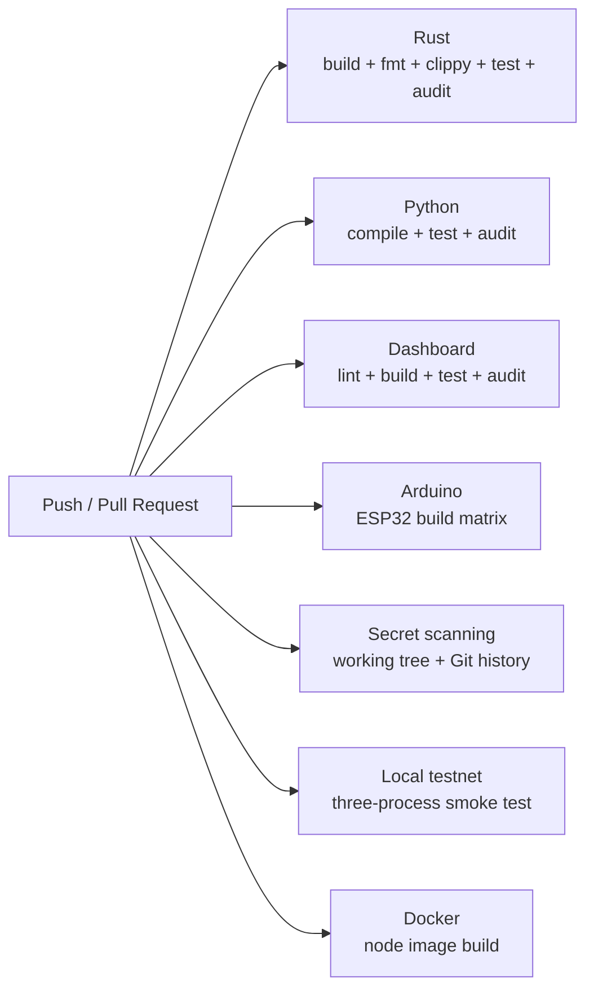

Basic local checks:

```bash
cargo fmt --all -- --check
cargo clippy --locked --workspace --all-targets -- -D warnings
cargo test --locked --workspace

python -m pip install -e "./provisioning[test]" -e "./gateway" -e "./indexer[test]"
python -m pytest -q provisioning/tests gateway/tests indexer/tests scripts/tests
python scripts/check-secrets.py --history

cd dashboard
npm ci
npm run lint
npm test
```

CI also:

- Scans the Rust, Python, and production dashboard dependencies for
  vulnerabilities.
- Verifies the shared Rust protocol vector and confirms that the Arduino vector
  example builds.
- Builds the ESP32 examples and additional ESP32 targets.
- Verifies that production builds reject an L0 identity.
- Builds the Docker node image.

Details: [`docs/ci.md`](docs/ci.md).

<a id="limitations"></a>
## Known limitations

- The working device implementation is currently centered on ESP32; other
  embedded families are not ready yet.
- The current ESP32 development identity is an L0 software key stored in NVS; it
  is neither hardware-backed nor unclonable.
- No physical end-to-end Wi-Fi test has been completed.
- Signed V3 state persistence is covered by automated tests. A physical ESP32
  restart test historically passed with V2; the physical V3 rerun is still
  pending.
- Single-node development randomness is not secure or unbiased production
  randomness.
- The current node does not advance epochs on a wall-clock timer; an authorized
  caller must invoke the epoch-finalization endpoint.
- The three-process test does not provide real P2P synchronization or Byzantine
  finality.
- The indexer does not yet have a published, trusted validator-key checkpoint
  with which to independently verify the authenticity of validator signatures.
- The dashboard encrypts the wallet locally. While the wallet is unlocked, XSS
  in the browser or a malicious extension could misuse signing operations.
- The production provisioning ceremony, HSM/offline CA, signed OTA, rollback,
  and independent security audit are not yet complete.

<a id="documentation"></a>
## Documentation

### Read these first

| Document | When should you read it? |
|---|---|
| [`PROTOCOL.md`](PROTOCOL.md) | To understand what the protocol signs and hashes |
| [`THREAT_MODEL.md`](THREAT_MODEL.md) | To see what the system trusts and what it does not protect against |
| [`docs/architecture.md`](docs/architecture.md) | To examine component boundaries in detail |
| [`docs/consensus.md`](docs/consensus.md) | To understand PoPED, epochs, and commit/reveal logic |
| [`SECURITY.md`](SECURITY.md) | To report a vulnerability privately |

### Running and operations

| Document | Topic |
|---|---|
| [`docs/local-testnet.md`](docs/local-testnet.md) | Local node processes and Docker |
| [`node/README.md`](node/README.md) | Node configuration, state format, and API |
| [`arduino/README.md`](arduino/README.md) | Arduino library and miner examples |
| [`provisioning/README.md`](provisioning/README.md) | Device-enrollment CLI |
| [`gateway/README.md`](gateway/README.md) | UART gateway |
| [`indexer/README.md`](indexer/README.md) | SQLite indexer and export |
| [`dashboard/README.md`](dashboard/README.md) | PWA, wallet, and dashboard |

### Hardware and security

| Document | Topic |
|---|---|
| [`docs/supported-boards.md`](docs/supported-boards.md) | Target board families and qualification method |
| [`docs/security-classes.md`](docs/security-classes.md) | L0–L4 classes |
| [`docs/hardware-testing.md`](docs/hardware-testing.md) | Safe physical testing sequence |
| [`docs/wifi-provisioning.md`](docs/wifi-provisioning.md) | Setup without placing Wi-Fi credentials in source code |
| [`docs/wallet-security.md`](docs/wallet-security.md) | Browser-wallet security boundary |
| [`docs/production-hardening.md`](docs/production-hardening.md) | Requirements before production deployment |
| [`arduino/HARDWARE_TEST_REPORT.md`](arduino/HARDWARE_TEST_REPORT.md) | Privacy-preserving physical test summary |

<a id="roadmap"></a>
## Roadmap

Primary goals:

1. Real, tested platform adapters for embedded families other than ESP32.
2. L3 identity using secure elements such as ATECC608A/ECC508.
3. Verified L2 hardware-identity paths for ESP32 families.
4. Signed and reproducible OTA, rollback, and measured boot.
5. HSM-backed CA, dual control, and certificate lifecycle management.
6. Real P2P peer synchronization and a production-grade finality protocol.
7. Long-running fuzzing, power-loss, and storage-wear testing.
8. Independent protocol and cryptography audits.

Full list: [`ROADMAP.md`](ROADMAP.md).

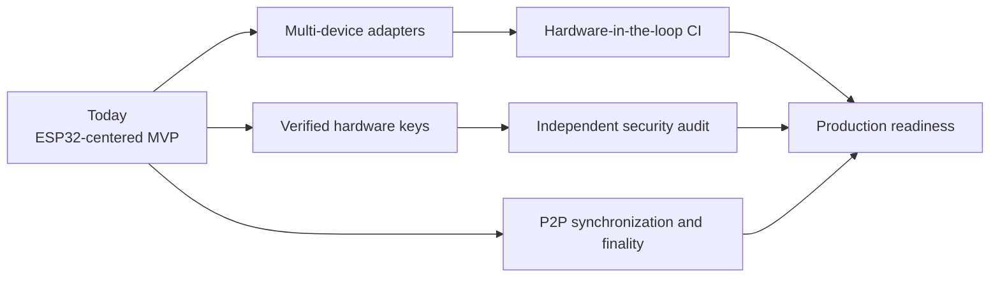

<a id="contributing"></a>
## Contributing and security reports

Before contributing:

1. Read the README for the component you will change.
2. If you are changing consensus data, review `PROTOCOL.md` and the binary V1
   specification.
3. Report evidence for new board support separately as “planned,” “build,” and
   “physical test.”
4. Do not commit private keys, Wi-Fi credentials, device identities, or raw
   hardware output.
5. Run the relevant tests and secret scan.

Do not disclose vulnerabilities in a public issue. Use
[`SECURITY.md`](SECURITY.md) for private reporting instructions.

<a id="license"></a>
## License

This project is released under the [MIT License](LICENSE).
