# Embedded Proof-of-Device Network (EPDN)

**Kayıtlı gömülü cihazların, işlem gücü yarışı yapmadan bir test ağına
katılmasını araştıran açık kaynaklı bir MVP.**

[](https://github.com/UfkuAcik/EPDN-Network/actions/workflows/ci.yml)


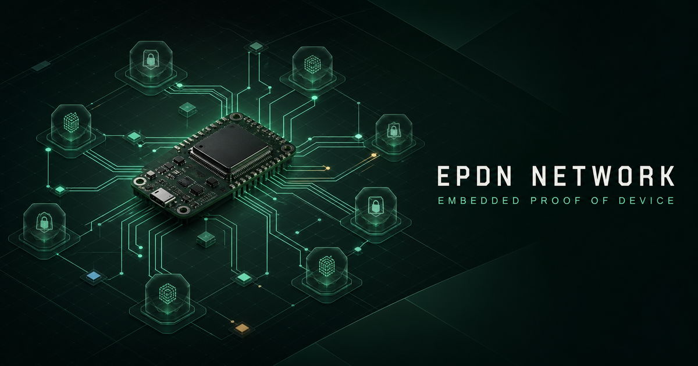

> [!WARNING]
> EPDN bir **araştırma ve geliştirme test ağıdır**. Üretim ağı, yatırım ürünü,
> gerçek değeri olan kripto para veya bağımsız güvenlik denetiminden geçmiş bir
> sistem değildir. Test anahtarları ve test birimleri gerçek para gibi
> değerlendirilmemelidir.

<a id="bir-dakikada-epdn"></a>
## Bir dakikada EPDN

EPDN'yi bir çekiliş gibi düşünebilirsiniz:

1. Bir gömülü cihaz önce ağa kaydedilir.
2. Ağ, her **30 saniyelik turda** kayıtlı kimliğe en fazla bir bilet hakkı
   verir.
3. Cihaz bileti kendi özel anahtarıyla imzalar.
4. Validator bileti, cihaz sertifikasını ve ağ kurallarını doğrular.
5. Sayısal puanı en düşük geçerli bilet turu kazanır.
6. Kazananın belirttiği cüzdan adresine yalnızca test ağında kullanılan ödül
   yazılır.

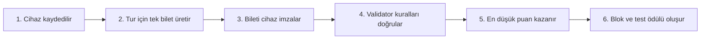

Buradaki önemli fark şudur: klasik Proof of Work sistemlerinde daha fazla işlem
gücü daha fazla deneme sağlar. EPDN'de aynı kayıtlı kimlik için hızlı işlemci,
GPU, FPGA veya ASIC kullanmak ek bilet sağlamaz.

> [!IMPORTANT]
> Bu MVP'de “bir cihaz”, teknik olarak **bir kayıtlı kriptografik kimlik**
> anlamına gelir. Mevcut geliştirme anahtarı kopyalanabilirse iki fiziksel cihaz
> aynı kimliği kullanabilir. Gerçek fiziksel benzersizlik iddiası için
> doğrulanmış, dışarı aktarılamayan bir donanım anahtarı gerekir.

<a id="icindekiler"></a>
## İçindekiler

- [Bir dakikada EPDN](#bir-dakikada-epdn)
- [Proje hangi problemi araştırıyor?](#hangi-problem)
- [EPDN nedir, ne değildir?](#nedir-ne-degildir)
- [Mevcut durum](#mevcut-durum)
- [Temel kavramlar sözlüğü](#sozluk)
- [Sistem mimarisi](#mimari)
- [Bileşenler ve görevleri](#bilesenler)
- [Uçtan uca çalışma akışı](#calisma-akisi)
- [PoPED nasıl çalışır?](#poped)
- [Bir epoch içinde ne olur?](#epoch)
- [Cihaz kimliği ile cüzdan neden ayrıdır?](#anahtar-ayrimi)
- [Donanım desteği](#donanim-destegi)
- [Güvenlik sınıfları](#guvenlik-siniflari)
- [Güven ve tehdit modeli](#guven-modeli)
- [Gizlilik ve veri sınırları](#gizlilik)
- [Hızlı başlangıç](#hizli-baslangic)
  - [Yol 1: Yalnızca arayüzü görmek](#arayuz-demo)
  - [Yol 2: Yerel validator ve dashboard](#yerel-validator)
  - [Yol 3: Üç süreçli test](#uc-surecli-test)
  - [Yol 4: ESP32 kodunu derlemek](#esp32-derleme)
- [Depo yapısı](#depo-yapisi)
- [API özeti](#api-ozeti)
- [Testler ve kalite kapıları](#testler)
- [Bilinen sınırlar](#sinirlar)
- [Belgeler](#belgeler)
- [Yol haritası](#yol-haritasi)
- [Katkı ve güvenlik bildirimi](#katki)
- [Lisans](#lisans)

---

<a id="hangi-problem"></a>
## Proje hangi problemi araştırıyor?

Birçok blokzincir sistemi katılımcıları işlem gücü, para veya başka bir kıt
kaynak üzerinden sınırlar. EPDN şu soruyu araştırır:

> “Önceden kaydedilmiş bir gömülü cihaz kimliğine her turda yalnızca bir
> katılım hakkı verirsek, işlem gücü yarışına gerek kalmadan belirlenebilir ve
> doğrulanabilir bir test ağı kurabilir miyiz?”

Bu yaklaşım üç şeyi birbirinden ayırır:

- **Cihazın katılım kimliği:** Cihazın bilet imzalamasına yarar.
- **Cüzdan sahipliği:** Ödülü almak ve transfer imzalamak için kullanılır.
- **Ağ doğrulaması:** Validator bütün sertifika, imza, tekrar ve durum
  kurallarını uygular.

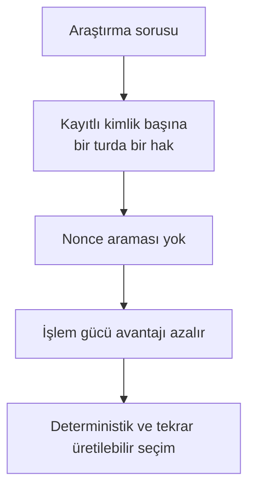

<a id="nedir-ne-degildir"></a>
## EPDN nedir, ne değildir?

| EPDN... | Açıklama |
|---|---|
| **Deneysel bir test ağıdır** | Protokol, cihaz, validator ve arayüz birlikte denenebilir. |
| **Proof-of-device fikrini araştırır** | Katılım hakkı kayıtlı kriptografik kimliğe bağlanır. |
| **Deterministiktir** | Aynı geçerli girdiler aynı bilet sırasını ve sonucu üretir. |
| **Çok bileşenli bir örnektir** | Rust, Arduino/C++, Python ve TypeScript parçaları birlikte çalışır. |
| **Güvenliği açıkça sınırlar** | Desteklenmeyen üretim ayarları sessizce zayıf moda düşmez. |

| EPDN... değildir | Neden? |
|---|---|
| **Ana ağ veya gerçek kripto para değildir** | Birimler yalnız test amacı taşır ve gerçek değer sözü yoktur. |
| **Proof of Work değildir** | Nonce arama ve hash gücü yarışı bulunmaz. |
| **Fiziksel cihaz benzersizliği garantisi değildir** | Mevcut ESP32 geliştirme anahtarı yazılım depolamasındadır. |
| **Tam merkeziyetsiz ağ değildir** | Çalışan MVP tek validator modeline sahiptir. |
| **Üretime hazır değildir** | Bağımsız denetim, P2P finality ve doğrulanmış donanım anahtarları eksiktir. |
| **Her gömülü kartı bugün desteklemez** | Protokol taşınabilir tasarlanmıştır; çalışan cihaz katmanı şu an ESP32 merkezlidir. |

<a id="mevcut-durum"></a>
## Mevcut durum

| Alan | Bugünkü durum |
|---|---|
| Protokol ve kurallar | Rust ile uygulanmış ve test ediliyor |
| Validator node | Yerel geliştirme için çalışan REST/SSE servisi |
| Cihaz yazılımı | Arduino ekosisteminde ESP32 merkezli |
| Fiziksel test | Klasik ESP32 ailesinde UART gateway akışı doğrulandı |
| Ek ESP32 hedefleri | ESP32-S2, ESP32-S3 ve ESP32-C3 için `WiFiMiner` CI'da derleniyor |
| Diğer gömülü aileler | Mimari hedef/yol haritası; hazır ve doğrulanmış istemci yok |
| Dashboard ve cüzdan | Yerel çalışabilen, kurulabilir PWA |
| Indexer | Yeniden oluşturulabilir SQLite görünümü ve JSON dışa aktarma |
| Üç validator deneyi | Üç ayrı yerel API süreci ve deterministik karşılaştırma testi |
| Üretim modu | Tasarım hedefi; henüz kullanılabilir üretim ağı değil |

Projenin uzun vadeli hedefi yalnız ESP32 değildir. Ancak README boyunca
**uygulandı**, **yalnızca derlendi**, **fiziksel olarak test edildi** ve
**planlandı** ifadeleri özellikle ayrı tutulur.

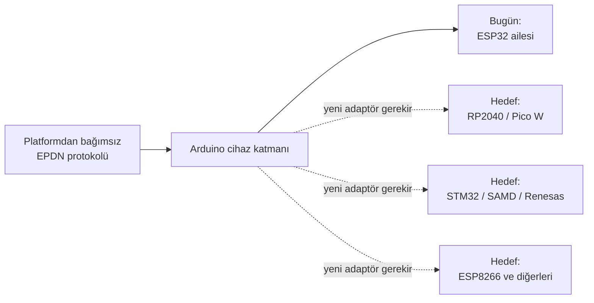

<a id="sozluk"></a>
## Temel kavramlar sözlüğü

| Kavram | Basit açıklama |
|---|---|
| **Node / Validator** | Ağ kurallarını uygulayan ve geçerli blok oluşturan Rust servisi. |
| **Miner / Cihaz** | Her turda kendi kayıtlı kimliğiyle en fazla bir bilet hazırlayan gömülü cihaz. |
| **Provisioning** | Cihaza geliştirme kimliği/sertifikası verme ve onu validator'a kaydetme işlemi. |
| **Cihaz sertifikası** | Bir cihaz anahtarının bu test ağına kabul edildiğini gösteren imzalı kayıt. |
| **Epoch** | Varsayılan olarak 30 saniye süren bir ağ turu. |
| **Ticket / Bilet** | Cihazın o tura katılımını temsil eden deterministik veri. |
| **PoPED** | `Proof of Provisioned Embedded Device`; kayıtlı kimlik başına tek bilet kuralı. |
| **Gateway** | UART ile gelen, zaten imzalanmış veriyi node'a taşıyan güvensiz kabul edilen köprü. |
| **Indexer** | Kesinleşmiş bloklardan sorgulanabilir bir SQLite görünümü üretir. |
| **Wallet / Cüzdan** | Test birimlerini alıp göndermek için ayrı anahtar kullanan yerel tarayıcı cüzdanı. |
| **PWA** | Tarayıcıdan açılıp desteklenen sistemlerde uygulama gibi kurulabilen web arayüzü. |
| **Hash** | Bir verinin sabit uzunlukta dijital parmak izi. Veri değişirse hash de değişir. |
| **Kanonik** | Aynı bilginin herkes tarafından yalnızca tek bir geçerli bayt düzeninde yazılması. |
| **REST / SSE** | REST istek-cevap API'sidir; SSE node olaylarını dashboard'a anlık iletir. |
| **CI** | Her kod değişikliğinde derleme, test ve güvenlik kontrollerini otomatik çalıştıran sistem. |
| **P2P / Finality** | Node'ların doğrudan haberleşmesi ve bir bloğun artık değişmeyeceği konusunda anlaşması. |
| **Secure element** | Özel anahtarı dışarı vermeden cihaz içinde imza üreten ayrı güvenlik çipi. |
| **L0–L4** | Cihaz anahtarının ne kadar güçlü korunduğunu anlatan güvenlik sınıfları. |

<a id="mimari"></a>
## Sistem mimarisi

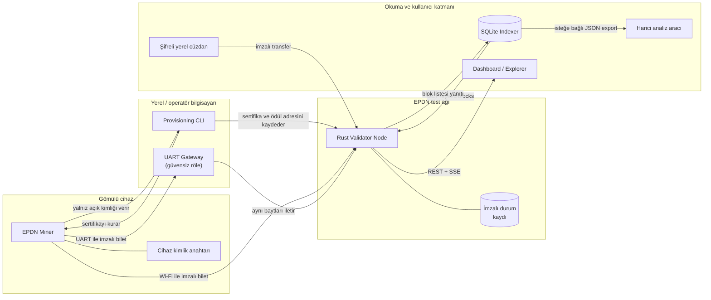

Okların anlamı önemlidir:

- Gateway cihaz adına imza üretmez; yalnızca bayt taşır.
- Miner cüzdanın özel anahtarını bilmez; yalnızca ödülün gideceği açık adresi
  bilir.
- Indexer doğruluğun ana kaynağı değildir; validator verisinden silinip yeniden
  oluşturulabilir.
- JSON yalnız API sınırında kullanılır. İmzalanan ve hash'lenen değerler sabit
  sıralı `EPDN Binary Encoding v1` biçimindedir.

<a id="bilesenler"></a>
## Bileşenler ve görevleri

| Bileşen | Dil | Ne yapar? | Ne yapmaz? |
|---|---|---|---|
| [`protocol/`](protocol/) | Rust | Kodlama, sertifika, bilet, blok, işlem ve seçim kuralları | HTTP arayüzü veya cihaz sürücüsü içermez |
| [`node/`](node/) | Rust | Validator, kayıt defteri, epoch, ödül, transfer, iptal, REST/SSE ve kalıcı durum | Üretim sınıfı P2P konsensüs sağlamaz |
| [`arduino/`](arduino/) | C++ / Arduino | Cihaz kimliği, bilet motoru, Wi-Fi/UART miner örnekleri | Bugün bütün kart ailelerini desteklemez |
| [`provisioning/`](provisioning/) | Python | İnceleme, geliştirme kaydı, yükleme, izleme ve iptal araçları | MVP'de geri döndürülemez eFuse değişikliği yapmaz |
| [`gateway/`](gateway/) | Python | UART cihazıyla node arasında sınırlı veri rölesi | Özel anahtar tutmaz ve cihaz yerine imza atmaz |
| [`indexer/`](indexer/) | Python / SQLite | Kesinleşmiş blokları doğrulayıp sorgulanabilir görünüm üretir | Validator'ın yerine geçmez |
| [`dashboard/`](dashboard/) | TypeScript / React | Explorer, cihaz paneli, PWA ve şifreli yerel cüzdan | Validator yokken sahte canlı ağ izlenimi vermez; demo etiketi gösterir |
| [`scripts/testnet.py`](scripts/testnet.py) | Python | Üç yerel node sürecini başlatır ve smoke testi çalıştırır | Bu süreçleri P2P eşlerine dönüştürmez |

<a id="calisma-akisi"></a>
## Uçtan uca çalışma akışı

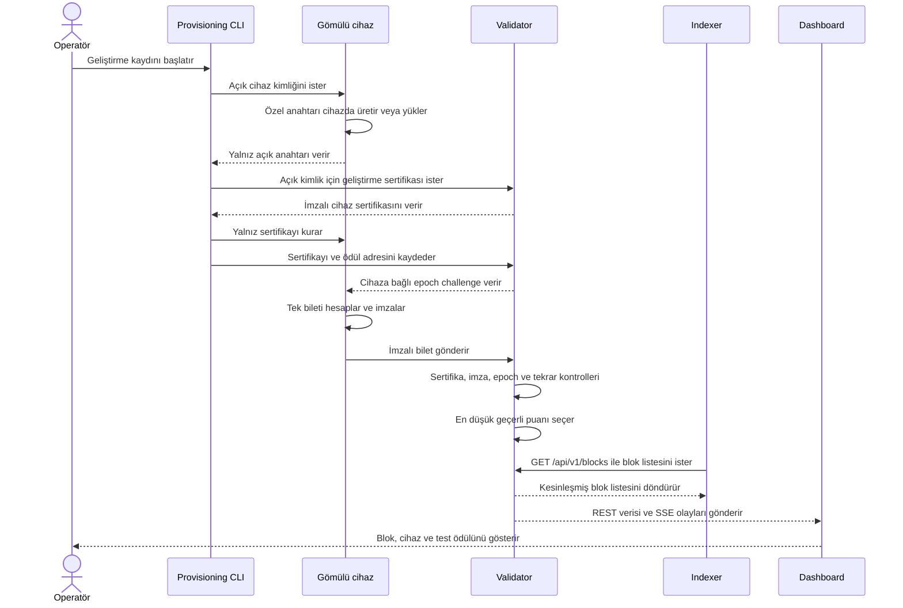

Bir biletin kabul edilmesi için yalnızca imzanın doğru olması yetmez. Validator
aynı zamanda ağ kimliğini, epoch'u, önceki blok bağını, firmware politikasını,
sertifika süresini, güvenlik sınıfını, iptal durumunu, paket boyutunu ve tekrar
gönderimini de kontrol eder.

<a id="poped"></a>
## PoPED nasıl çalışır?

`Proof of Provisioned Embedded Device (PoPED)`, kayıtlı her kimliğe bir epoch
için en fazla bir deterministik sonuç verir.

Basitleştirilmiş mantık:

```text
bilet = SHA256("EPDN_TICKET_V1" || cihaz_açık_anahtar_hash || epoch_challenge)
puan  = SHA256("EPDN_SCORE_V1"  || bilet)
```

İmza, cihazın kayıtlı özel anahtara sahip olduğunu kanıtlar. Fakat imza baytları
bilet puanına katılmaz. Böylece aynı mesaj için farklı geçerli ECDSA imzaları
üretmek daha iyi puan aramak için kullanılamaz.

| Özellik | Proof of Work | EPDN PoPED MVP |
|---|---|---|
| Katılım kaynağı | Hesaplama gücü | Kayıtlı cihaz kimliği |
| Tur başına deneme | Donanım hızına göre çok sayıda | Kimlik başına en fazla bir |
| Nonce araması (çok sayıda değer deneyerek çözüm arama) | Var | Yok |
| Daha hızlı GPU/ASIC avantajı | Genellikle var | Aynı kimlik için ek bilet sağlamaz |
| Temel güven varsayımı | Ekonomik ve hesaplama maliyeti | Provisioning otoritesi ve cihaz anahtarı |
| Fiziksel cihaz garantisi | Yok | MVP'de yok; donanım destekli anahtar gerektirir |

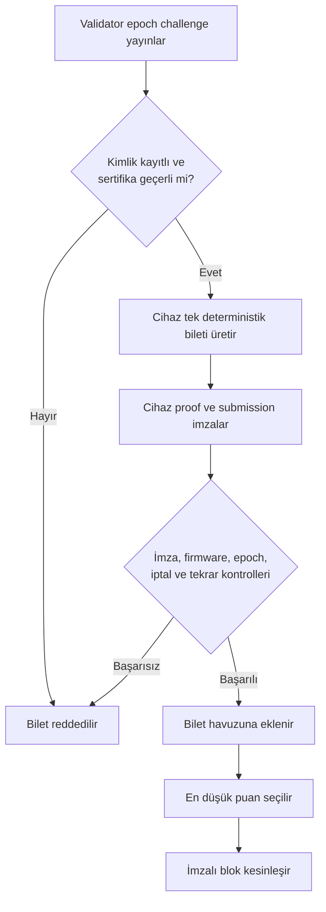

Ayrıntılı biçim ve güvenlik gerekçesi:
[`PROTOCOL.md`](PROTOCOL.md) ve
[`docs/consensus.md`](docs/consensus.md).

<a id="epoch"></a>
## Bir epoch içinde ne olur?

Varsayılan epoch süresi **30 saniyedir**:

- İlk 20 saniye: bilet gönderim penceresi.
- Son 10 saniye: sonlandırma penceresi.
- Geçerli biletler arasından deterministik kazanan seçilir.
- Transferler ve iptaller ancak bir bloğa girdiklerinde kesinleşir.

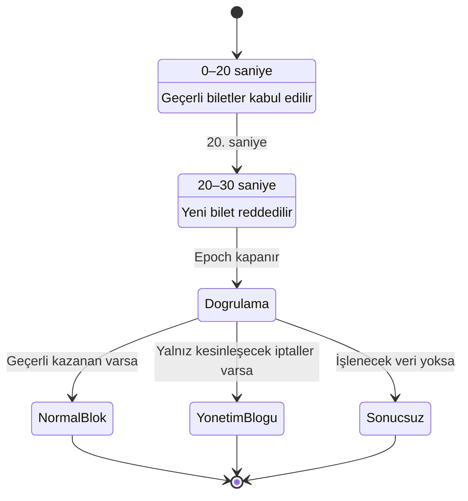

Paketlerin node'a ulaşma sırası kazananı belirlemek için kullanılmaz. Eşitlik
halinde cihaz açık anahtar hash'i ve submission hash'i gibi kanonik değerler
kullanılır.

<a id="anahtar-ayrimi"></a>
## Cihaz kimliği ile cüzdan neden ayrıdır?

EPDN iki farklı özel anahtar kullanır:

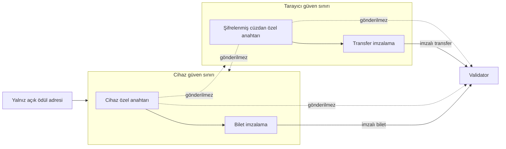

- **Cihaz anahtarı**, miner'ın kayıtlı katılımcı olduğunu kanıtlar.
- **Cüzdan anahtarı**, test birimlerini harcama yetkisi verir.
- Miner yalnızca açık ödül adresini bilir.
- Cüzdan özel anahtarının firmware'e yazılması tasarım ihlalidir.
- Cihaz özel anahtarının dashboard'a gönderilmesi de tasarım ihlalidir.

<a id="donanim-destegi"></a>
## Donanım desteği

### Etiketler ne anlama geliyor?

| Etiket | Anlamı |
|---|---|
| **Fiziksel test** | Kod gerçek bir kartta çalıştırılmış ve davranış gözlenmiştir. |
| **CI derleme** | Kod hedef için derlenmiştir; gerçek kartta çalıştığı iddia edilmez. |
| **Planlı** | Mimari hedef vardır; tamamlanmış ve doğrulanmış destek yoktur. |

### Güncel destek tablosu

| Donanım / aile | Durum | Kapsam |
|---|---|---|
| Klasik ESP32 ailesi | **Fiziksel test + CI derleme** | UART gateway, protokol vektörü, kayıt, bilet, ödül ve iptal akışı |
| ESP32-S2 | **CI derleme** | Yalnız `WiFiMiner`; fiziksel test yok |
| ESP32-S3 | **CI derleme** | Yalnız `WiFiMiner`; fiziksel test yok |
| ESP32-C3 | **CI derleme** | Yalnız `WiFiMiner`; fiziksel test yok |
| ESP32-C2/C5/C6/C61/H2/P4 | **Planlı** | Modele uygun ağ ve kimlik adaptörü gerekir |
| ESP8266 | **Planlı** | Hazır/doğrulanmış miner yok |
| RP2040 / Raspberry Pi Pico W | **Planlı** | Hazır/doğrulanmış miner yok |
| SAMD / Nano / MKR ailesi | **Planlı** | Kart ve secure-element yetenekleri ayrıca doğrulanmalı |
| STM32 Arduino çekirdekleri | **Planlı** | MCU ve kart bazında adaptör gerekir |
| Renesas Arduino çekirdekleri | **Planlı** | Hedef bazında adaptör gerekir |
| ATECC608A / ECC508 | **Planlı** | Mevcut örnek fail-closed placeholder; gerçek entegrasyon değil |

> [!NOTE]
> ESP32-S2/S3/C3 için derleme başarısı, Wi-Fi uçtan uca testi veya fiziksel
> donanım doğrulaması anlamına gelmez. Klasik ESP32 üzerindeki fiziksel test de
> kartın özel anahtarını donanım seviyesinde klonlanamaz yapmaz.

Fiziksel kanıtlar:
[`arduino/HARDWARE_TEST_REPORT.md`](arduino/HARDWARE_TEST_REPORT.md) ve
[`arduino/board-configs/support-matrix.json`](arduino/board-configs/support-matrix.json).

<a id="guvenlik-siniflari"></a>
## Güvenlik sınıfları

EPDN, kimlik saklama gücünü L0'dan L4'e kadar sınıflandırır:

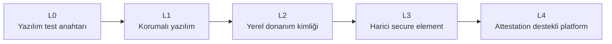

| Sınıf | Basit anlamı | Bu depodaki durum |
|---|---|---|
| **L0** | Dışarı aktarılabilir geliştirme/test anahtarı | Mevcut ESP32 geliştirme yolu |
| **L1** | Yazılımın erişebildiği fakat daha korumalı saklama | Hedefe özel kanıt gerekir |
| **L2** | İmzalama işlemi yerel donanıma bağlı | Henüz doğrulanmış genel backend yok |
| **L3** | Anahtar secure element dışına çıkmaz | ATECC entegrasyonu planlı |
| **L4** | Platform ölçümlerini imzalı attestation ile sunar | Tasarım hedefi |

Üretim politikası L0 kimliği reddeder. Bir kartın adında “secure” veya “ESP32”
geçmesi tek başına ona L2/L4 sınıfı vermez. Ayrıntılar:
[`docs/security-classes.md`](docs/security-classes.md).

<a id="guven-modeli"></a>
## Güven ve tehdit modeli

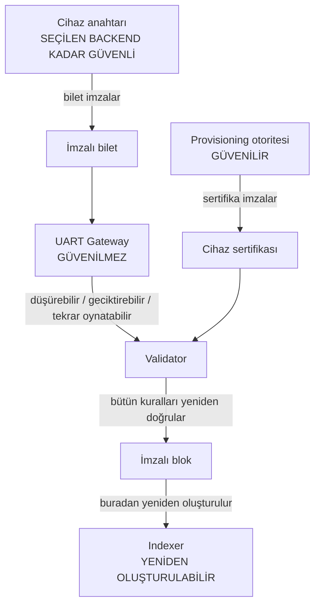

Sistem şu kabullere dayanır:

- Provisioning otoritesi sahte kimlik üretmemelidir.
- Validator'ın CA ve blok imzalama anahtarları korunmalıdır.
- Cihaz anahtarının güven seviyesi seçilen backend kadar güçlüdür.
- Gateway güvenilir sayılmaz; node gelen veriyi yeniden doğrular.
- MAC adresi, IP adresi, RSSI, kart modeli, reset nedeni veya zamanlama cihaz
  kimliğinin güven kökü değildir.

Önemli korumalar:

- P-256 imzaları ve SHA-256 alan ayrımlı hash'ler.
- Sabit sıralı, boyutları sınırlı kanonik binary kodlama.
- Kimlik başına epoch'ta tek bilet ve tekrar/replay kontrolleri.
- Sertifika, firmware, güvenlik sınıfı ve iptal politikaları.
- İmzalı, checksum'lı ve atomik V3 node durum kaydı.
- Loopback dışına açılan node için güçlü admin token'ı, kesin CORS listesi ve
  birbirinden farklı CA/validator anahtarları zorunluluğu.
- Desteklenmeyen üretim backend'lerinde sessiz zayıflatma yerine hata.

Tam tehdit modeli: [`THREAT_MODEL.md`](THREAT_MODEL.md).

<a id="gizlilik"></a>
## Gizlilik ve veri sınırları

EPDN anonimlik ürünü değildir. Bloklar, işlemler, ödül adresleri ve genel cihaz
kimlikleri test ağının herkese açık verileri olabilir. Buradaki gizlilik hedefi,
gereksiz kişisel ve cihaz-tanımlayıcı verilerin kaynak koda, loglara ve genel
explorer'a sızmasını önlemektir.

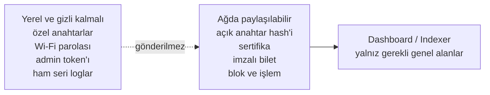

| Veri | Olması gereken yer |
|---|---|
| Cihaz özel anahtarı | Yalnız cihazın seçilen kimlik backend'i |
| Cüzdan özel anahtarı | Şifreli IndexedDB kaydı ve kilit açıkken tarayıcı belleği |
| Wi-Fi parolası | Etkileşimli yerel giriş ve cihazın yerel depolaması |
| Admin token'ı | Yerel/runtime ortam değişkeni |
| Ham seri port çıktısı | Git tarafından yok sayılan yerel test klasörü |
| Açık cihaz kimliği ve sertifika | Test ağı kayıt defteri |
| Bloklar ve imzalı işlemler | Genel test ağı verisi |
| Kişisel cihaz etiketi | Yalnız yetkili dashboard uygulama verisi |

Şunları issue, commit, ekran görüntüsü veya genel log içine koymayın:

- Özel anahtarlar ve kurtarma verileri
- Wi-Fi SSID/parolaları
- Admin token'ları
- Tam seri port dökümleri
- MAC adresleri, USB kimlikleri ve benzersiz çip kimlikleri
- eFuse/security posture dökümleri
- Kişisel dosya yolları, kullanıcı adları veya e-posta adresleri

<a id="hizli-baslangic"></a>
## Hızlı başlangıç

Önce ne görmek istediğinizi seçin:

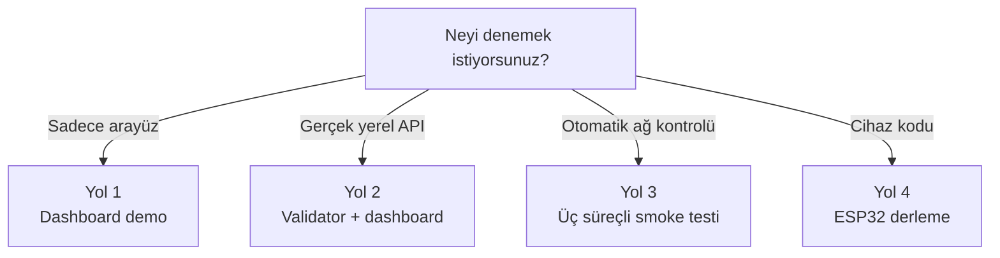

### Gereksinimler

Yalnız kullanacağınız yolun araçlarını kurmanız yeterlidir.

| Araç | Sürüm | Nerede gerekli? |
|---|---:|---|
| Git | Güncel | Depoyu indirmek için |
| Rust | 1.85 | Protokol ve node |
| Python | 3.11+ | Provisioning, gateway, indexer ve testnet scripti |
| Node.js | 22.13+ | Dashboard/PWA |
| Arduino CLI | 1.5.0 | ESP32 kodunu derlemek |
| ESP32 Arduino core | 2.0.11 | ESP32 hedefleri |
| Docker | İsteğe bağlı | Node container'ı |

Depoyu indirin:

```bash
git clone https://github.com/UfkuAcik/EPDN-Network.git
cd EPDN-Network
```

<a id="arayuz-demo"></a>
### Yol 1: Yalnızca arayüzü görmek

Bu yol için fiziksel cihaz, Rust veya Python gerekmez. Validator bulunamazsa
dashboard açıkça **DEMO DATA** etiketi gösterir ve deterministik örnek veri
kullanır.

```bash
cd dashboard
npm ci
npm run dev
```

Tarayıcıda [http://localhost:3000](http://localhost:3000) adresini açın.

Beklenen sonuç:

- Explorer ekranı açılır.
- Örnek bloklar ve cihazlar görünür.
- Üstte bunun canlı ağ değil demo verisi olduğu belirtilir.
- Demo modunda transfer veya iptal işlemi gerçek ağa gönderilmez.

<a id="yerel-validator"></a>
### Yol 2: Yerel validator ve dashboard

#### 1. Validator'ı başlatın

Depo kökünde:

```bash
cargo run -p epdn-node
```

Node varsayılan olarak yalnızca `127.0.0.1:8745` üzerinde dinler. Sağlık
kontrolü:

```bash
curl http://127.0.0.1:8745/healthz
```

Loopback geliştirme modunda yerel ve kasıtlı olarak güvensiz varsayılan
anahtarlar kullanılabilir. Node'u başka bilgisayarların erişimine açmadan önce
[`node/README.md`](node/README.md) içindeki zorunlu güvenlik değişkenlerini
okuyun.

#### 2. Dashboard'u node'a bağlayın

Yeni bir terminal açın.

PowerShell:

```powershell
Set-Location dashboard
$env:EPDN_API_BASE_URL = "http://127.0.0.1:8745"
npm ci
npm run dev
```

Bash:

```bash
cd dashboard
npm ci
EPDN_API_BASE_URL=http://127.0.0.1:8745 npm run dev
```

Dashboard'daki API alanında da `http://127.0.0.1:8745` seçilebilir. Bağlantı
başarılıysa veri kaynağı demo yerine canlı node olarak görünür.

<a id="uc-surecli-test"></a>
### Yol 3: Üç süreçli test

```bash
python scripts/testnet.py smoke
```

Bu komut:

1. Güncel `epdn-node` kodunu derler.
2. `8745`, `8746` ve `8747` portlarında üç ayrı yerel süreç başlatır.
3. Sağlık ve temel ağ bilgilerini kontrol eder.
4. Üç validator'lı deterministik commit/reveal testini çalıştırır.
5. Süreçleri kapatır ve geçici durumu temizler.

Portlar doluysa:

```bash
python scripts/testnet.py --ports 18745,18746,18747 smoke
```

> [!CAUTION]
> Bu üç süreç birbirine blok veya oy gönderen P2P eşler değildir. Test,
> bağımsız API süreçlerini ve aynı protokol girdilerindeki deterministik sonucu
> doğrular; Byzantine finality kanıtlamaz.

<a id="esp32-derleme"></a>
### Yol 4: ESP32 kodunu derlemek

Önce sabitlenmiş ESP32 çekirdeğini kurun:

```bash
arduino-cli config init
arduino-cli config add board_manager.additional_urls https://espressif.github.io/arduino-esp32/package_esp32_index.json
arduino-cli core update-index
arduino-cli core install esp32:esp32@2.0.11
```

Donanıma hiçbir şey yüklemeden tanı örneğini derleyin:

```bash
arduino-cli compile \
  --fqbn esp32:esp32:esp32 \
  --libraries arduino/libraries \
  arduino/examples/SecurityDiagnostic
```

PowerShell'de aynı komut tek satır olarak da çalıştırılabilir:

```powershell
arduino-cli compile --fqbn esp32:esp32:esp32 --libraries arduino/libraries arduino/examples/SecurityDiagnostic
```

Diğer örnekler:

| Örnek | Amaç |
|---|---|
| `SecurityDiagnostic` | Hedefin bildirdiği güvenlik yeteneklerini güvenli biçimde inceler |
| `SerialProvisioning` | Wi-Fi ve geliştirme kayıt verisini seri bağlantıdan alır |
| `WiFiMiner` | Node ile doğrudan Wi-Fi üzerinden konuşur |
| `GatewayMiner` | İmzalı bileti UART gateway üzerinden yollar |
| `ProtocolTestVectors` | Rust ve Arduino kodlamasının aynı baytları ürettiğini kontrol eder |
| `SecureElementMiner` | Planlanan secure-element yolunun fail-closed placeholder'ıdır |

> [!CAUTION]
> Derleme donanımı değiştirmez; **upload** işlemi karttaki mevcut uygulamayı
> değiştirir. Doğru kart/FQBN ve portu kendiniz doğrulamadan yükleme yapmayın.
> Bu proje eFuse, Secure Boot, Flash Encryption, JTAG veya anti-rollback
> ayarlarını otomatik olarak değiştirmez.

Cihaz kurulumu için:
[`arduino/README.md`](arduino/README.md),
[`docs/hardware-testing.md`](docs/hardware-testing.md) ve
[`docs/wifi-provisioning.md`](docs/wifi-provisioning.md).

<a id="depo-yapisi"></a>
## Depo yapısı

```text
EPDN-Network/
├── protocol/       Konsensüs kuralları ve kanonik binary kodlama
├── node/           Rust validator, REST/SSE API ve kalıcı durum
├── arduino/        EPDN cihaz kütüphanesi ve ESP32 örnekleri
├── provisioning/   Cihaz kayıt ve yönetim CLI'ı
├── gateway/        UART ile node arasında imzalı veri rölesi
├── indexer/        SQLite okuma modeli ve JSON dışa aktarma
├── dashboard/      Explorer, cihaz paneli ve yerel cüzdan PWA
├── scripts/        Testnet çalıştırıcısı ve secret tarayıcısı
├── tests/          Gizlilik korunmuş donanım kanıtları
├── docs/           Mimari ve operasyon belgeleri
├── PROTOCOL.md     Protokol güven sınırı
├── THREAT_MODEL.md Tehdit modeli
├── ROADMAP.md      Planlanan geliştirmeler
└── SECURITY.md     Güvenlik açığı bildirim kuralları
```

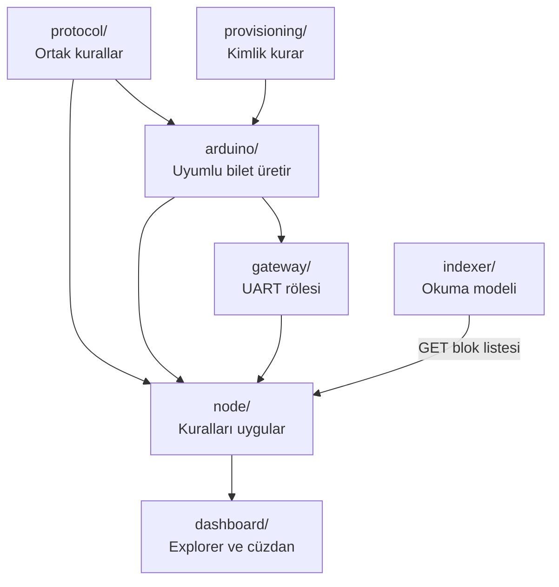

<a id="api-ozeti"></a>
## API özeti

Node iki tür endpoint sunar:

| Tür | Örnekler | Yetki |
|---|---|---|
| Sağlık/ağ | `/healthz`, `/metrics`, `/api/v1/network/status` | Genel |
| Epoch ve bilet | `/api/v1/epochs/current`, `/api/v1/tickets` | Challenge genel; bilet kriptografik olarak doğrulanır |
| Blok ve hesap | `/api/v1/blocks`, `/api/v1/address/{address}` | Genel |
| Cihaz görünümü | `/api/v1/miners`, `/api/v1/miners/{public_id}` | Genel alanlar |
| Olay akışı | `/api/v1/events` | Genel SSE |
| Kayıt ve yönetim | `/api/v1/admin/enroll`, `/api/v1/admin/register`, `/api/v1/admin/miners/{public_id}/revoke` | Admin token'ı |
| Transfer | `/api/v1/transactions` | Cüzdan imzası |

API'lerin tam listesi ve ortam değişkenleri:
[`node/README.md`](node/README.md).

<a id="testler"></a>
## Testler ve kalite kapıları

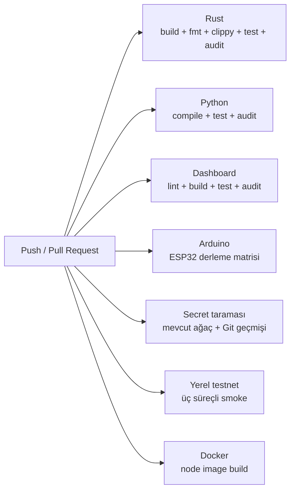

Yerel temel kontroller:

```bash
cargo fmt --all -- --check
cargo clippy --locked --workspace --all-targets -- -D warnings
cargo test --locked --workspace

python -m pip install -e "./provisioning[test]" -e "./gateway" -e "./indexer[test]"
python -m pytest -q provisioning/tests gateway/tests indexer/tests scripts/tests
python scripts/check-secrets.py --history

cd dashboard
npm ci
npm run lint
npm test
```

CI ayrıca:

- Rust, Python ve üretim dashboard bağımlılıklarını güvenlik açıklarına karşı
  tarar.
- Rust ortak protokol vektörünü doğrular ve Arduino vektör örneğinin
  derlendiğini kontrol eder.
- ESP32 örneklerini ve ek ESP32 hedeflerini derler.
- Üretim build'inde L0 kimliğinin reddedildiğini doğrular.
- Docker node imajını oluşturur.

Detaylar: [`docs/ci.md`](docs/ci.md).

<a id="sinirlar"></a>
## Bilinen sınırlar

- Çalışan cihaz uygulaması bugün ESP32 merkezlidir; diğer gömülü aileler henüz
  hazır değildir.
- Mevcut ESP32 geliştirme kimliği NVS içindeki L0 yazılım anahtarıdır; donanım
  destekli veya klonlanamaz değildir.
- Fiziksel Wi-Fi uçtan uca testi yapılmamıştır.
- İmzalı V3 durum kaydı otomatik testlidir; fiziksel ESP32 ile yeniden başlatma
  testi V2'de tarihsel olarak geçmiş, V3 fiziksel tekrarı beklemektedir.
- Tek node geliştirme rastgeleliği güvenli veya tarafsız üretim rastgeleliği
  değildir.
- Üç süreçli test gerçek P2P senkronizasyonu veya Byzantine finality sunmaz.
- Indexer, validator imzasının gerçekliğini bağımsız doğrulamak için henüz
  yayımlanmış güvenilir validator anahtar checkpoint'ine sahip değildir.
- Dashboard cüzdanı yerelde şifreler; cüzdan açıkken tarayıcıdaki XSS veya zararlı
  eklenti imza işlemini kötüye kullanabilir.
- Üretim provisioning töreni, HSM/çevrimdışı CA, imzalı OTA, rollback ve
  bağımsız güvenlik denetimi henüz tamamlanmamıştır.

<a id="belgeler"></a>
## Belgeler

### Önce bunları okuyun

| Belge | Ne zaman okunmalı? |
|---|---|
| [`PROTOCOL.md`](PROTOCOL.md) | Protokolün neyi imzalayıp hash'lediğini anlamak için |
| [`THREAT_MODEL.md`](THREAT_MODEL.md) | Sistemin neye güvendiğini ve neye karşı korumadığını görmek için |
| [`docs/architecture.md`](docs/architecture.md) | Bileşen sınırlarını ayrıntılı incelemek için |
| [`docs/consensus.md`](docs/consensus.md) | PoPED, epoch ve commit/reveal mantığı için |
| [`SECURITY.md`](SECURITY.md) | Güvenlik açığını özel olarak bildirmek için |

### Çalıştırma ve operasyon

| Belge | Konu |
|---|---|
| [`docs/local-testnet.md`](docs/local-testnet.md) | Yerel node süreçleri ve Docker |
| [`node/README.md`](node/README.md) | Node yapılandırması, durum formatı ve API |
| [`arduino/README.md`](arduino/README.md) | Arduino kütüphanesi ve miner örnekleri |
| [`provisioning/README.md`](provisioning/README.md) | Cihaz kayıt CLI'ı |
| [`gateway/README.md`](gateway/README.md) | UART gateway |
| [`indexer/README.md`](indexer/README.md) | SQLite indexer ve export |
| [`dashboard/README.md`](dashboard/README.md) | PWA, cüzdan ve dashboard |

### Donanım ve güvenlik

| Belge | Konu |
|---|---|
| [`docs/supported-boards.md`](docs/supported-boards.md) | Hedeflenen kart aileleri ve yeterlilik yöntemi |
| [`docs/security-classes.md`](docs/security-classes.md) | L0–L4 sınıfları |
| [`docs/hardware-testing.md`](docs/hardware-testing.md) | Güvenli fiziksel test sırası |
| [`docs/wifi-provisioning.md`](docs/wifi-provisioning.md) | Wi-Fi bilgisini kaynak koda koymadan kurulum |
| [`docs/wallet-security.md`](docs/wallet-security.md) | Tarayıcı cüzdanının güvenlik sınırı |
| [`docs/production-hardening.md`](docs/production-hardening.md) | Üretime geçmeden önce gerekenler |
| [`arduino/HARDWARE_TEST_REPORT.md`](arduino/HARDWARE_TEST_REPORT.md) | Gizlilik korunmuş fiziksel test özeti |

<a id="yol-haritasi"></a>
## Yol haritası

Başlıca hedefler:

1. ESP32 dışındaki gömülü aileler için gerçek, test edilen platform adaptörleri.
2. ATECC608A/ECC508 gibi secure element'larla L3 kimliği.
3. ESP32 aileleri için doğrulanmış L2 donanım kimliği yolları.
4. İmzalı ve tekrar üretilebilir OTA, rollback ve measured boot.
5. HSM destekli CA, çift kontrol ve sertifika yaşam döngüsü.
6. Gerçek P2P eş senkronizasyonu ve üretim sınıfı finality protokolü.
7. Uzun süreli fuzzing, güç kesintisi ve depolama aşınma testleri.
8. Bağımsız protokol ve kriptografi denetimi.

Tam liste: [`ROADMAP.md`](ROADMAP.md).

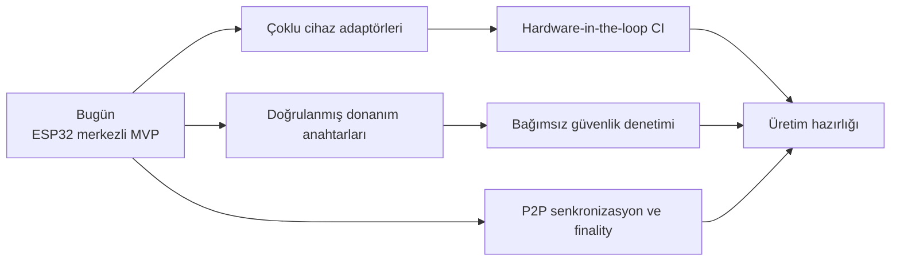

<a id="katki"></a>
## Katkı ve güvenlik bildirimi

Katkı yapmadan önce:

1. Değiştireceğiniz bileşenin README'sini okuyun.
2. Konsensüs verisini değiştiriyorsanız `PROTOCOL.md` ve binary V1
   spesifikasyonunu inceleyin.
3. Yeni kart desteğini “planlı”, “derleme” ve “fiziksel test” kanıtlarıyla ayrı
   raporlayın.
4. Özel anahtar, Wi-Fi bilgisi, cihaz kimliği veya ham donanım çıktısı commit
   etmeyin.
5. İlgili testleri ve secret taramasını çalıştırın.

Güvenlik açığını genel issue içinde yayımlamayın. Özel bildirim yöntemi için
[`SECURITY.md`](SECURITY.md) dosyasını kullanın.

<a id="lisans"></a>
## Lisans

Bu proje [MIT Lisansı](LICENSE) ile yayımlanır.
