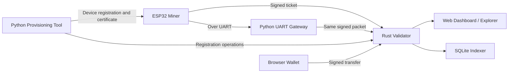

# EPDN Beginner’s Guide

> This document explains the **Embedded Proof-of-Device Network — EPDN** project in a way that can be understood without prior expertise in blockchain, cryptography, or embedded systems.

## What does this project do?

EPDN is an experimental network in which embedded devices such as ESP32 boards can participate.

Unlike Bitcoin mining, devices do not continuously perform calculations and compete through processing power.

Instead, the system follows this rule:

> Each registered device identity may create only one lottery ticket in each round. Among all valid tickets, the ticket with the lowest numerical value wins.

In other words:

```text
More processing power = More tickets
```

is not how EPDN works.

The intended rule is:

```text
One registered device identity = At most one ticket per round
```

This approach is called:

**Proof of Provisioned Embedded Device — PoPED**

In simple terms, it means:

> Proof that a previously registered embedded-device identity participated in the current round.

---

## The simplest example: A neighborhood lottery

The system can be imagined as a neighborhood lottery.

There is a lottery organizer. In this project, that organizer is the **validator**, also called the validator node.

Instead of people, ESP32 devices participate in the lottery.

Each ESP32:

1. Is first registered with the network.
2. Uses its own digital identity.
3. Creates only one ticket in each round.
4. Signs the ticket using its private key.
5. Sends the signed ticket to the validator.
6. Has its ticket checked by the validator.
7. Wins if its valid ticket has the lowest numerical value.
8. Receives a test reward at its registered wallet address.

Although the system creates blockchain-like blocks, it is not currently a real cryptocurrency network.

---

# How does the system work?

## 1. The device creates its digital identity

When an ESP32 is first initialized, it can create two cryptographic keys:

* A **private key**
* A **public key**

The private key can be thought of as the device’s secret signature stamp.

It must not be shared with anyone.

The public key is the public identity that allows the device to be recognized by the network.

A simple analogy:

```text
Public key  = Identity number
Private key = A secret signature stamp held only by the owner
```

When the device sends data, it signs that data with its private key.

The validator uses the public key to verify that the signature really belongs to that registered device identity.

---

## 2. The device is registered with the network

An ESP32 cannot immediately participate in the lottery.

It must first go through a registration process called **provisioning**.

The provisioning software generally performs the following steps:

1. Retrieves the ESP32’s public device identity.
2. Requests a certificate for the device from the validator.
3. Installs the certificate on the ESP32.
4. Adds the device to the validator’s registry.
5. Registers the wallet address that should receive the device’s rewards.

After this process, the validator accepts the following statement:

> This device identity is recognized by the network and may participate in lottery rounds.

Administrator authorization is required to prevent devices from being added to the network without control.

---

## 3. A new round begins

Each lottery round in EPDN is called an **epoch**.

In the protocol design, an epoch lasts approximately 30 seconds:

* First 20 seconds: Devices may submit tickets.
* Final 10 seconds: The round is closed and the winner is selected.

In the current MVP, epochs do not advance using an automatic wall-clock scheduler.

An administrator or test program must finalize the round by calling:

```text
POST /api/v1/admin/epochs/finalize
```

Therefore, the documented 30-second structure represents the intended protocol schedule. In the current development server, a separate command is still required to close the round.

---

## 4. The validator publishes a challenge

The validator creates a different **challenge** for every epoch.

The challenge is a piece of data unique to that round.

It can be understood as:

> This is the common lottery value for round 128.

Each device combines its identity with this challenge to create its ticket.

---

## 5. The ESP32 calculates its single ticket

In simplified form, the ticket is generated like this:

```text
Ticket = SHA256(Device identity + Epoch challenge)
```

The real protocol uses special domain labels and a fixed-order binary data format to prevent different fields from being confused with each other.

The simplified version of the actual logic is:

```text
ticket =
    SHA256(
        "EPDN_TICKET_V1"
        + device public-key hash
        + epoch challenge
    )
```

A score is then calculated for the ticket:

```text
score = SHA256("EPDN_SCORE_V1" + ticket)
```

This produces a large numerical value.

For example:

```text
ESP32-A score: 8417254
ESP32-B score: 2104983
ESP32-C score: 5928761
```

ESP32-B wins because it has the lowest score.

---

## Why can the device not try repeatedly?

In Bitcoin-like Proof-of-Work systems, devices search for a suitable hash by trying different nonce values.

For example:

```text
Attempt 1 → Failed
Attempt 2 → Failed
Attempt 3 → Failed
...
Attempt 10,000,000 → Suitable result found
```

For this reason, faster hardware can perform more attempts.

EPDN does not use a nonce-search loop.

The same device identity and the same epoch challenge always produce the same result.

```text
Same device + Same round = Same ticket
```

Even if the device runs the calculation a thousand times, it cannot obtain a better ticket.

The validator also prevents the same registered identity from submitting a second ticket in the same epoch.

---

## 6. The ESP32 signs its ticket

The ESP32 signs its participation data using its private key.

This signature proves the following to the validator:

> This ticket was submitted by someone who possesses the private key belonging to the registered device identity.

The private key is never sent to the validator.

Only the following information travels over the network:

* The device’s public identity
* The device certificate
* Epoch information
* The ticket
* The digital signature
* Other required protocol fields

This can be imagined as a sealed letter:

```text
Letter = Lottery ticket
Seal   = Device digital signature
```

The validator verifies the seal, but the secret signing key never leaves the device.

---

## 7. The validator checks the ticket

A valid digital signature alone is not enough.

The validator also checks:

* Is the device registered?
* Is the device certificate valid?
* Has the certificate expired?
* Has the device been revoked or banned?
* Does the ticket belong to the correct network?
* Was the ticket created for the correct epoch?
* Does it reference the correct previous block?
* Is the firmware version allowed?
* Is the device security class sufficient?
* Has the device already submitted a ticket in this round?
* Has the same packet already been used?
* Is an old packet being replayed?
* Is the packet format valid?
* Is the packet within the permitted size limits?
* Is the digital signature valid?

If any check fails, the ticket is rejected.

For example, the system may return errors such as:

```text
duplicate_device_epoch
duplicate_ticket
stale_epoch_replay
revoked_device
unregistered_device
wrong_network
invalid_signature
```

---

## 8. The winner is selected

The validator collects all valid tickets.

It then selects the ticket with the lowest numerical score.

The order in which packets arrive at the validator does not determine the winner.

The system does not use this rule:

```text
The first device to submit wins.
```

It uses this rule:

```text
The valid ticket with the lowest score wins.
```

If two values are equal, deterministic values such as the device public-key hash and submission hash are used as tie-breakers.

Network arrival order is not used to select the winner.

---

## 9. A block is created

After the winner is selected, the validator creates a new block.

A block generally contains:

* Epoch number
* Previous block hash
* Winning ticket
* Winning device identity
* Reward information
* Transactions
* Device-registry state
* Revoked-device state
* Firmware and security policies
* Validator signature

A simplified example:

```text
Block height: 42
Epoch: 41
Winning device: ESP32-B
Reward address: epdn1...
Previous block: a4c82...
Current block: 91fb7...
```

Because each block references the previous block, the system creates a blockchain-like chain of records.

---

# System components

EPDN is not a single program.

Several components work together.



---

## ESP32 Miner

This is the device software running on the ESP32.

Its responsibilities include:

* Creating or loading the device identity
* Storing the certificate
* Retrieving the epoch challenge from the validator
* Calculating the device’s single ticket
* Signing the participation data
* Sending the signed packet to the validator

The project includes two main communication examples.

### WiFiMiner

The ESP32 connects directly to the validator over Wi-Fi.

```text
ESP32 → Wi-Fi → Validator
```

### GatewayMiner

The ESP32 sends its ticket to a computer over UART.

The gateway software running on the computer forwards the packet to the validator.

```text
ESP32 → UART → Gateway → Validator
```

---

## UART Gateway

The gateway is only a transport relay.

The gateway does not:

* Create a private key on behalf of the device
* Sign data on behalf of the device
* Generate lottery tickets
* Know the device private key

It only carries the packet that was created and signed by the ESP32.

It can be thought of as a delivery company:

> The delivery company is not the author of the letter. It only transports it.

If the gateway modifies the packet, signature verification fails.

If the gateway attempts to resend the packet, the validator rejects it using duplicate and replay checks.

---

## Provisioning CLI

This is a Python-based device-registration and management tool.

Its main functions include:

* Inspecting a device
* Enrolling a development device
* Requesting a certificate
* Installing the certificate on the device
* Registering the device with the validator
* Flashing firmware
* Monitoring the serial port
* Renewing a certificate
* Revoking a device
* Inspecting the security plan

Example command groups include:

```text
inspect
enroll-dev
register
flash
monitor
diagnose
renew-certificate
revoke
security-plan
```

The provisioning computer must be physically trusted.

A malicious computer with access to the USB or UART connection could otherwise attempt to manipulate the registration process.

---

## Rust Validator Node

The validator is the main decision-making component of the system.

It is written in Rust.

Its responsibilities include:

* Maintaining device registrations
* Verifying certificates
* Accepting or rejecting tickets
* Enforcing one ticket per device identity per round
* Selecting the winner
* Creating blocks
* Distributing test rewards
* Verifying wallet transfers
* Applying revocations
* Persisting system state
* Providing a REST API and SSE event stream

The default development address is:

```text
http://127.0.0.1:8745
```

This address is accessible only from the local computer.

If the validator is exposed to other computers, secure keys, a strong administrator token, and an explicit CORS allowlist must be configured.

---

## Dashboard and Explorer

The dashboard is the system’s web interface.

It can display:

* Recent blocks
* Current epoch state
* Registered devices
* Accepted tickets
* Winning devices
* Rewards
* Wallet balances
* Transfer history
* Device statistics

If the dashboard cannot connect to a validator, it can display sample data.

In that case, the interface shows a **DEMO DATA** warning so that users know the information is not coming from a live network.

---

## Browser wallet

The device identity and wallet identity are separate.

The system uses two different private keys.

### Device private key

Proves that the device is a registered miner.

```text
Device key → Ticket signing
```

### Wallet private key

Authorizes the transfer of test units to another address.

```text
Wallet key → Transfer signing
```

The ESP32 knows only the public wallet address that receives rewards.

The wallet private key must not be placed inside the ESP32 firmware.

Likewise, the dashboard must not receive the device private key.

This separation helps prevent a compromised miner from automatically gaining permission to spend wallet funds.

---

## Indexer

The indexer reads blocks from the validator and builds a SQLite database.

Its purpose is to make network data easier to search.

For example:

* How many times has a device won?
* How many rewards has an address received?
* Which devices were selected in the last 100 blocks?
* Which block contains a particular transaction?

The indexer can be deleted and rebuilt from validator block data.

Therefore, the indexer is not the ultimate source of truth.

The validated block history maintained by the validator is the authoritative source.

---

# Full example workflow

An ESP32 joins and participates in the system as follows:

```text
1. The Rust validator is started on a computer.

2. The EPDN miner firmware is installed on the ESP32.

3. The ESP32 creates its private and public keys.

4. The provisioning tool retrieves the public key from the ESP32.

5. The provisioning tool requests a device certificate from the validator.

6. The certificate is installed on the ESP32.

7. The device and reward wallet address are registered with the validator.

8. The ESP32 connects to the network over Wi-Fi or UART.

9. The ESP32 retrieves the current epoch challenge from the validator.

10. The ESP32 calculates its single ticket.

11. The ESP32 signs the participation packet using its private key.

12. The signed packet is sent to the validator.

13. The validator checks the certificate, signature, epoch, and replay rules.

14. If valid, the ticket is added to the ticket pool.

15. When the epoch is finalized, the lowest score is selected.

16. The validator creates a new block.

17. A test reward is credited to the winner’s registered wallet address.

18. The dashboard displays the new block and reward.
```

---

# Why does powerful hardware not provide an advantage?

The ticket result is fixed for the same registered identity.

Even if the same private key is used on:

* An ESP32
* A powerful desktop computer
* A GPU
* An FPGA
* An ASIC

the same epoch still produces the same ticket.

Faster hardware cannot create more valid tickets for the same identity.

```text
1 registered identity
        ↓
1 epoch
        ↓
At most 1 valid ticket
```

However, this rule limits the number of registered cryptographic identities, not necessarily the number of physical devices.

This distinction is extremely important.

---

# Does the system prove a real physical device?

Not completely in its current form.

In the current ESP32 development path, the private key is stored in ordinary NVS memory.

This is classified as **L0** security in the project.

An L0 key:

* Is accessible by software
* Can potentially be copied
* Can potentially be moved to another device
* Does not guarantee a unique physical device

Therefore, in the current MVP:

```text
One device = One registered cryptographic identity
```

It does not yet guarantee:

```text
One device = One unique and unclonable physical board
```

A real physical-device guarantee requires hardware that does not allow the private key to be exported.

Possible solutions include:

* A secure element such as ATECC608A
* Hardware-bound key storage
* ESP32 eFuse-based identity
* Secure Boot
* Flash Encryption
* Measured boot
* Remote attestation

These features are part of the project’s future goals.

---

# What happens if the same key is copied to two ESP32 boards?

If two ESP32 boards use the same private key, the network sees them as the same device identity rather than two separate devices.

If both boards submit a ticket for the same epoch:

* Both produce the same ticket.
* The first valid submission may be accepted.
* The second submission is rejected as a duplicate.

Therefore, copying the same key to 100 boards does not provide 100 separate lottery tickets in the same epoch.

However, if an attacker manages to register 100 different device identities, the attacker receives 100 participation opportunities.

This makes the **provisioning authority** one of the most important trust points in the system.

If the provisioning authority is malicious or compromised, it could register fraudulent device identities.

---

# Security classes

EPDN classifies device-key protection from L0 to L4.

| Class  | Simple explanation                             | Current status                    |
| ------ | ---------------------------------------------- | --------------------------------- |
| **L0** | Exportable software test key                   | Current ESP32 development path    |
| **L1** | More protected software storage                | Requires device-specific evidence |
| **L2** | Signing operation bound to local hardware      | No generally verified backend yet |
| **L3** | Key never leaves a secure element              | Planned                           |
| **L4** | Device proves measurements through attestation | Long-term target                  |

Production policy rejects L0 devices.

A board does not automatically qualify as L2, L3, or L4 merely because its product name includes the word “secure.”

A real security classification requires measurement and verifiable hardware evidence.

---

# Is the network decentralized?

No.

The current working MVP uses a single-validator model.

```text
ESP32 devices
       ↓
Single Rust validator
       ↓
Blocks and test rewards
```

The project includes a test that can start three separate validator processes.

However, these three processes currently do not:

* Establish P2P connections
* Exchange blocks
* Exchange votes or finality messages
* Synchronize a shared blockchain

The purpose of the test is to verify whether separate validator processes produce the same mathematical result from identical protocol inputs.

Therefore, the current three-process test is not:

* A real P2P network
* Byzantine Fault Tolerant consensus
* Production finality
* Proof of full decentralization

Real decentralization remains a future development goal.

---

# Is this a cryptocurrency?

Not currently.

EPDN is not:

* A mainnet
* A system that produces assets with real economic value
* An investment product
* A token traded on exchanges
* An independently audited security system
* A production-ready network

The units awarded to winning devices are test-network units only.

They exist to test features such as:

* Reward distribution
* Balance tracking
* Transfer signing
* Block creation
* Wallet operations

---

# The main research question

EPDN explores the following question:

> Can we build a verifiable network without a race for processing power by giving every registered embedded-device identity only one participation opportunity per round?

In traditional Proof-of-Work systems, participation power is largely determined by:

* Processor performance
* Number of GPUs
* ASIC hardware
* Electricity consumption
* Hardware investment

EPDN instead explores tying participation rights to registered device identities.

```text
Proof of Work:
More computation → Greater chance of winning

EPDN PoPED:
More registered identities → More participation opportunities
```

This approach reduces the competition for processing power, but it makes the security of the device-registration process extremely important.

---

# Possible use cases

Although the project is still experimental, a similar architecture could eventually be used for:

* IoT device networks
* Rewarding sensor participation
* Hardware-based distributed systems
* Device-identity verification networks
* Embedded-system test networks
* Low-power blockchain-like systems
* Rotating task assignment between devices
* Smart-city sensor networks
* Distributed measurement and telemetry systems
* Experimental protocols based on hardware participation

These examples are possible future applications, not claims that the current version is ready for production use.

---

# Quick start

## Requirements

Depending on which part of the project you want to use, you may need some of the following tools:

| Tool               | Used for                           |
| ------------------ | ---------------------------------- |
| Git                | Cloning the repository             |
| Rust               | Protocol and validator             |
| Python 3.11+       | Provisioning, gateway, and indexer |
| Node.js            | Dashboard and PWA                  |
| Arduino CLI        | Compiling ESP32 code               |
| ESP32 Arduino Core | ESP32 targets                      |
| Docker             | Optional validator container       |

---

## Clone the repository

```bash
git clone https://github.com/UfkuAcik/Embedded_Proof-of-Device_Network.git
cd Embedded_Proof-of-Device_Network
```

---

## View only the dashboard

You can inspect the interface without physical ESP32 hardware or a running validator.

```bash
cd dashboard
npm ci
npm run dev
```

Open the following address in your browser:

```text
http://localhost:3000
```

If no validator is available, the dashboard displays sample data and clearly identifies it as demo data.

---

## Start the local validator

From the repository root:

```bash
cargo run -p epdn-node
```

Check its health:

```bash
curl http://127.0.0.1:8745/healthz
```

By default, the validator is accessible only from the local computer.

---

## Connect the dashboard to the local validator

PowerShell:

```powershell
Set-Location dashboard
$env:EPDN_API_BASE_URL = "http://127.0.0.1:8745"
npm ci
npm run dev
```

Bash:

```bash
cd dashboard
npm ci
EPDN_API_BASE_URL=http://127.0.0.1:8745 npm run dev
```

When the connection succeeds, the dashboard displays data from the live validator instead of demo data.

---

## Compile the ESP32 code without uploading

First install Arduino CLI and the ESP32 core.

```bash
arduino-cli config init
arduino-cli config add board_manager.additional_urls https://espressif.github.io/arduino-esp32/package_esp32_index.json
arduino-cli core update-index
arduino-cli core install esp32:esp32@2.0.11
```

Compile the security diagnostic example:

```bash
arduino-cli compile \
  --fqbn esp32:esp32:esp32 \
  --libraries arduino/libraries \
  arduino/examples/SecurityDiagnostic
```

Compile the Wi-Fi miner example:

```bash
arduino-cli compile \
  --fqbn esp32:esp32:esp32 \
  --libraries arduino/libraries \
  arduino/examples/WiFiMiner
```

Compile the gateway miner example:

```bash
arduino-cli compile \
  --fqbn esp32:esp32:esp32 \
  --libraries arduino/libraries \
  arduino/examples/GatewayMiner
```

Compilation does not upload anything to the board.

The `upload` operation replaces the application currently running on the ESP32. Do not upload until the correct board model, FQBN, and serial port have been verified.

---

# Current hardware support

| Hardware                        | Status                     |
| ------------------------------- | -------------------------- |
| One classic ESP32-family target | Physical test and CI build |
| ESP32-S2                        | Builds in CI               |
| ESP32-S3                        | Builds in CI               |
| ESP32-C3                        | Builds in CI               |
| Other ESP32 models              | Planned                    |
| ESP8266                         | Planned                    |
| Raspberry Pi Pico W / RP2040    | Planned                    |
| STM32 Arduino cores             | Planned                    |
| SAMD / Nano / MKR               | Planned                    |
| Renesas Arduino targets         | Planned                    |
| ATECC608A / ECC508              | Secure integration planned |

Successful compilation in CI does not mean the code has been physically tested on real hardware.

---

# Repository structure

```text
Embedded_Proof-of-Device_Network/
├── protocol/       Shared protocol and binary-format rules
├── node/           Rust validator and API
├── arduino/        ESP32 device library and examples
├── provisioning/   Device enrollment and management tools
├── gateway/        UART-to-validator data relay
├── indexer/        SQLite database and data export
├── dashboard/      Explorer, device panel, and web wallet
├── scripts/        Test-network and helper scripts
├── tests/          Tests and hardware evidence
├── docs/           Technical documentation
├── PROTOCOL.md     Protocol fields that are signed and hashed
├── THREAT_MODEL.md Threat model
├── ROADMAP.md      Planned improvements
└── SECURITY.md     Security vulnerability reporting policy
```

---

# Important limitations

The current version has the following limitations:

1. The system is not a real mainnet.
2. It uses a single-validator model.
3. Real P2P synchronization is not implemented.
4. Production-grade finality is not implemented.
5. The ESP32 development key is L0 and can potentially be copied.
6. Physical-device uniqueness is not guaranteed.
7. Epochs do not advance using an automatic scheduler.
8. Physical end-to-end Wi-Fi testing is limited.
9. The production provisioning process is incomplete.
10. HSM or offline CA infrastructure is incomplete.
11. Secure-element integration is not yet a real backend.
12. The system has not undergone an independent security or cryptography audit.
13. Browser-wallet signing may be at risk from malicious browser extensions while the wallet is unlocked.
14. Test-network units have no real economic value.

---

# Information that must remain private

Do not place the following information in GitHub issues, commits, screenshots, or public logs:

* Device private keys
* Wallet private keys
* Recovery phrases
* Wi-Fi network names and passwords
* Validator administrator tokens
* Raw serial-port logs
* MAC addresses
* Unique USB-device identifiers
* eFuse dumps
* Security-configuration dumps
* Personal file paths
* Usernames
* Email addresses

Public identities, certificates, blocks, and signed test transactions may be public according to the network design.

EPDN is not an anonymity system.

---

# Short glossary

## Validator

The main server that enforces network rules and creates blocks.

## Miner

An embedded device that prepares one ticket per epoch.

## Provisioning

The process of creating a device identity, obtaining a certificate, and registering the device with the network.

## Certificate

A signed record proving that a device public key is accepted by the network.

## Epoch

A lottery round.

## Challenge

Round-specific data published by the validator for each epoch.

## Ticket

A deterministic lottery value created from the device identity and challenge.

## Score

The numerical hash result used to select the winner.

## Private key

A secret signing key that must remain with its owner.

## Public key

A public key used to recognize the device and verify its signatures.

## Hash

A fixed-length digital fingerprint of data.

## Gateway

A relay that transports signed UART data from the ESP32 to the validator.

## Indexer

A program that reads blocks and stores searchable data in SQLite.

## Wallet

A separate cryptographic identity used to receive and transfer test units.

## Replay attack

An attempt to reuse a previously valid packet by sending it again.

## Secure element

A security chip that stores a private key internally and performs signing without exporting the key.

## Attestation

Cryptographic proof of a device’s hardware and software state.

---

# One-sentence summary

> EPDN is an experimental Proof-of-Device network in which registered embedded-device identities such as ESP32 boards submit one deterministic ticket per round, while the current MVP uses a centralized Rust validator to select the lowest-scoring ticket and create a block with a test reward.

---

# Further technical documentation

For more detailed information, see:

* [`README.md`](README.md)
* [`PROTOCOL.md`](PROTOCOL.md)
* [`THREAT_MODEL.md`](THREAT_MODEL.md)
* [`docs/architecture.md`](docs/architecture.md)
* [`docs/consensus.md`](docs/consensus.md)
* [`docs/security-classes.md`](docs/security-classes.md)
* [`docs/production-hardening.md`](docs/production-hardening.md)
* [`arduino/README.md`](arduino/README.md)
* [`node/README.md`](node/README.md)

---

## Warning

EPDN is a research and development project.

Before it is used for real funds, production devices, or critical infrastructure, at least the following work should be completed:

* Hardware-backed and non-exportable device identities
* A real P2P validator network
* A production-grade finality protocol
* Secure provisioning infrastructure
* HSM-backed or offline certificate authority
* Signed and reproducible OTA updates
* Rollback and anti-rollback protection
* Long-running power-loss and storage testing
* Fuzz testing
* Independent security and cryptography audits

The test keys and test-network units in this repository must not be treated as real money or production identities.
